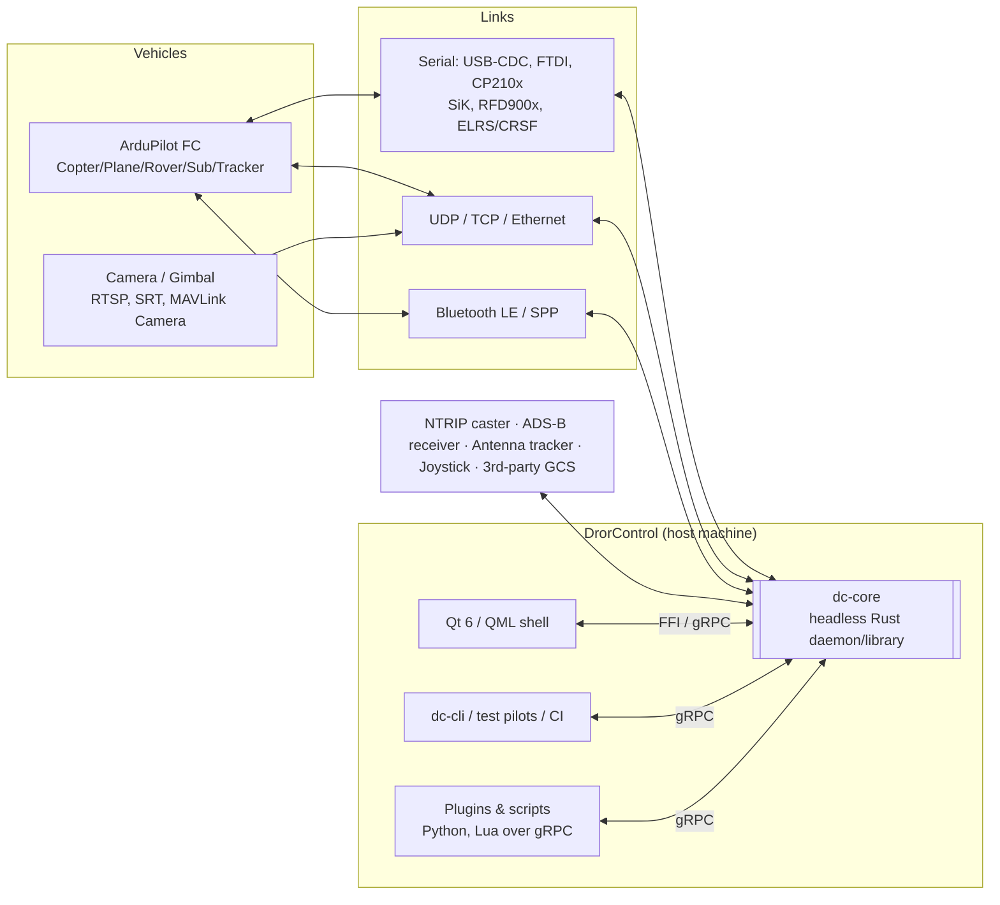
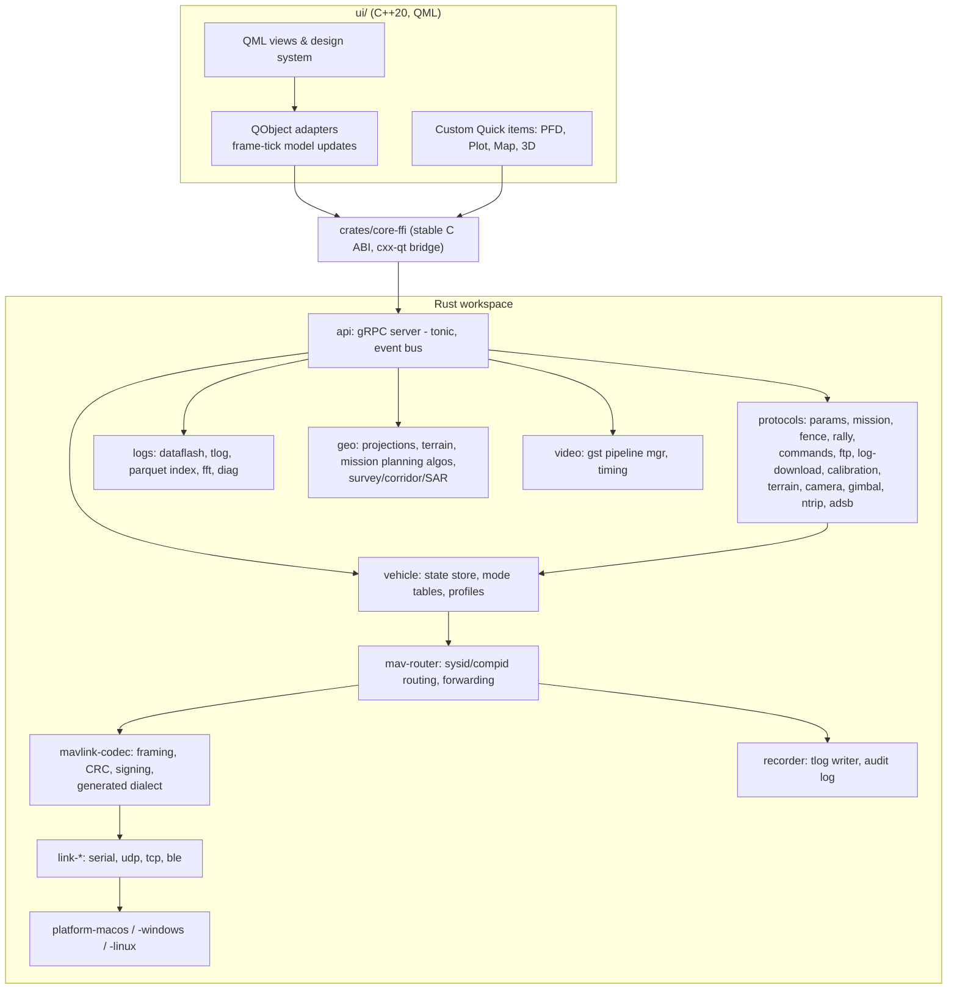
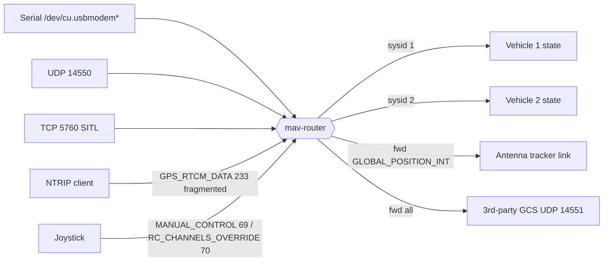
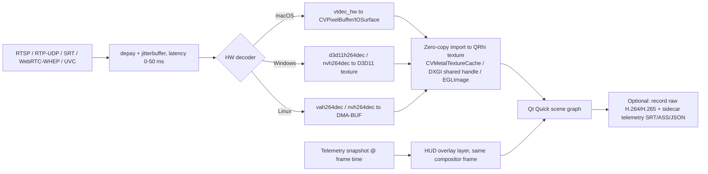

# 01 — Architectural Blueprint & Cross-Platform Technology Stack

## 1. Quality attributes that drive the design

| QA | Requirement | Architectural consequence |
|----|-------------|---------------------------|
| Responsiveness | UI thread never blocks on I/O or parsing; no dropped frames during telemetry bursts | Ingest/parse on dedicated threads; UI **pulls** immutable snapshots at vsync |
| Throughput | ≥ 20 k msg/s sustained; multi-GB logs | Zero-copy framing, lazy decode, mmap, columnar log store |
| Safety | Commands are explicit, acknowledged, auditable | Single command path with state machine, ACK tracking, audit log ([08](08-safety-vv.md)) |
| Portability | macOS (arm64/x86_64), Windows 10/11 (x64, arm64 later), Linux | Platform-specific code isolated in `platform-*` crates behind traits |
| Testability | Whole flight workflows run headless in CI against SITL | Core is a library + daemon with no UI dependency |
| Evolvability | New MAVLink dialects, vehicles, widgets | Code generation from XML/metadata; plugin API |
| Offline-first | Field use with no internet | All maps/terrain/help/params metadata cacheable and bundled |

## 2. Stack comparison & selection

### 2.1 Candidates

| Option | Core | UI | Rendering |
|--------|------|----|-----------|
| **A** | Rust | Tauri 2 (WKWebView / WebView2 / WebKitGTK) + TypeScript | WebGL/WebGPU in the webview |
| **B** | C++20 | Qt 6 / QML | Qt RHI (Metal / D3D11-12 / Vulkan) |
| **C** | C# (.NET 8/9) | Avalonia 11 | Skia (Metal / ANGLE-D3D / GL) |
| **D (selected)** | **Rust** | **Qt 6 / QML** via `cxx-qt` | Qt RHI (Metal) + `wgpu` (Metal/Vulkan/DX12) for custom 2-D/3-D scenes |

Also considered and rejected: Flutter (Impeller/Metal — weak multi-window docking, serial/video plugins immature for avionics), SwiftUI + separate Windows app (violates single code base; Swift/AppKit remains available *inside* the platform layer via `objc2`), Electron (memory/battery, no).

### 2.2 Weighted evaluation (1 = poor, 5 = excellent)

Weights reflect the brief: macOS fidelity and rendering are emphasised, throughput and correctness are safety-relevant.

| Criterion | Wt | A Tauri | B Qt/C++ | C Avalonia | **D Rust+Qt** |
|-----------|---:|:------:|:--------:|:----------:|:-------------:|
| macOS native fidelity (menus, gestures, dark/light, multi-window, Retina) | 20 | 3 | 4 | 4 | **4** |
| GPU pipeline / Metal path, frame pacing | 15 | 3 | 5 | 4 | **5** |
| Telemetry throughput & deterministic latency | 15 | 3 | 4 | 3 | **5** |
| Packaging, signing, notarization ergonomics | 10 | 4 | 4 | 4 | **3** |
| UI development velocity / talent pool | 10 | 5 | 3 | 4 | **3** |
| GCS ecosystem (maps, video, docking, serial, gamepad) | 10 | 3 | 5 | 2 | **5** |
| Memory safety / correctness of parsers & state machines | 10 | 5 | 2 | 4 | **5** |
| Reuse of legacy MP knowledge/code | 5 | 1 | 2 | 5 | **2** |
| Long-term maintenance risk | 5 | 3 | 4 | 3 | **3** |
| **Weighted total (/5)** | 100 | 3.40 | 3.85 | 3.65 | **4.15** |

Scores are architect judgement; **spikes S0-1…S0-6** (§9) exist to falsify them in Phase 0. Sensitivity: D stays first unless "UI velocity" is weighted > ~30 % (then A overtakes) or "memory safety" < ~3 % (then B ties).

### 2.3 Per-criterion notes

**macOS compatibility.**
* *Tauri*: WKWebView is Apple's engine and is power-efficient, but WebGPU availability and behaviour differs per OS/webview version (WebKitGTK on Linux lacks parity), multi-window docking and native menu routing are hand-rolled, video decode/overlay compositing is webview-bound, and the Gamepad Web API hides `GameController.framework` capabilities (haptics, motion, extended mappings).
* *Qt 6*: Qt Quick on macOS renders through **Qt RHI → Metal**; `QMenuBar` maps to the global `NSMenu`; `QNativeGestureEvent` delivers trackpad pinch/rotate/smart-zoom; system appearance changes arrive as `QStyleHints::colorScheme`; `QWindow` + `NSView` interop allows embedding native `CAMetalLayer` content. QGroundControl is a decade-long precedent for exactly this class of application.
* *Avalonia*: good Skia-Metal path and native menus, but the map/video/docking ecosystem is thinnest and `System.IO.Ports` needs a custom IOKit shim for robust hotplug anyway.
* *Rust core*: IOKit, CoreFoundation, GameController, IOSurface and CoreVideo are all reachable from Rust through `objc2`/`core-foundation`/`io-kit-sys` crates without a Swift shim.

**High-throughput MAVLink.** 100 Hz telemetry is *light* (a 921 600-baud serial link carries ≲ 1 500 typical frames/s); the real stress cases are Ethernet/UDP SITL, multi-vehicle swarms, and replaying logs at 16×. We therefore budget ≥ 20 k msg/s. Rust gives deterministic latency (no GC, no stop-the-world), `bytes`/`zerocopy` framing, and lock-free structures; the UI is isolated by construction (§3).

**Packaging.** Qt adds `macdeployqt` + re-signing of nested frameworks (known, scripted, §[03](03-macos-platform.md)); Rust produces static universal libs via `lipo`. Cost: the hybrid has two toolchains — mitigated with a single `just`/`cargo xtask` entry point and hermetic CI images.

### 2.4 Risk of the hybrid & mitigation
| Risk | Mitigation |
|------|-----------|
| `cxx-qt` maturity / API churn | Wrap **all** core access behind our own stable `core-ffi` crate (C ABI + FlatBuffers/Protobuf payloads). If `cxx-qt` fails spike S0-1, the shell links `core-ffi` directly from hand-written C++ `QObject`s. UI is replaceable without touching the core. |
| Two languages slow onboarding | Strict ownership: Rust = no Qt types; C++/QML = no protocol logic. Onboarding guide has a 1-day path per side ([06](06-documentation-system.md)). |
| Qt licensing | Dynamic LGPL linking + relinking notice + SBOM; or GPLv3 — decision in README §5 |

## 3. Decoupled system architecture

### 3.1 Context



### 3.2 Containers and crates



### 3.3 The four IPC planes

| Plane | Purpose | Mechanism (in-process / remote) | Semantics |
|-------|---------|-------------------------------|-----------|
| **P1 Control** | Commands, param R/W, mission transfer, config | Direct async calls through `core-ffi` / **gRPC (tonic)** over Unix domain socket / named pipe / TCP+mTLS | Request–response + server streaming; every call has an `OperationId`, cancellation, timeout |
| **P2 State** | Live telemetry (attitude, position, battery …) | **Lock-free double-buffered snapshot** (`arc-swap`/seqlock) read by UI at frame tick; remote = `StateStream` gRPC stream, server-side decimated per client | *Latest-value wins*; UI never queues; per-field age & validity flags |
| **P3 Events** | STATUSTEXT, mode change, arm/disarm, link up/down, command ACKs | Bounded MPSC with replay cursor; gRPC server streaming | Ordered, lossless (disk-backed overflow), idempotent via monotonic `seq` |
| **P4 Bulk** | Logs, tiles, terrain, firmware, video frames | mmap'd files + handle IDs; chunked gRPC; video via GPU shared surfaces | Zero-copy locally; resumable remotely |

**Why not ZeroMQ?** It adds a dependency and a second serialisation story without schema evolution guarantees; in-process FFI beats any socket for the default case, and gRPC/Protobuf already gives schemas, codegen in every language, auth (mTLS), and streaming. Shared-memory rings are used only *inside* P2 where a snapshot is the right abstraction. **Why not pure gRPC for the desktop path?** Serialisation + loopback adds latency/CPU and battery cost on laptops for data the UI reads 60×/s.

### 3.4 Telemetry data path & threading

```mermaid
sequenceDiagram
  participant IO as Link IO thread(s)
  participant DEC as Decode worker
  participant ST as State store (snapshot)
  participant REC as Recorder thread
  participant BUS as Event bus
  participant UI as UI thread (vsync)
  IO->>DEC: raw bytes (ring buffer, 1 MiB/link)
  DEC->>DEC: frame sync, CRC, (sig verify), route
  DEC->>REC: raw frame + timestamp (bounded chan, never blocks DEC)
  DEC->>ST: typed update for msgids with subscribers
  DEC->>BUS: events (STATUSTEXT, ACK, HEARTBEAT change)
  UI->>ST: load snapshot (wait-free)
  UI->>BUS: drain events (≤ N per frame)
  UI->>UI: update QObject properties once per frame; QML re-renders only dirty items
```

Rules (enforced by review checklist + tests):
1. **No locks on the UI thread**; only wait-free snapshot reads and bounded drains.
2. Decode is *lazy*: header peek → `msgid` → decode only if any consumer is subscribed (`HEARTBEAT` always).
3. The recorder is lossless; if disk stalls, it spills to an in-memory ring then raises a **visible** "recording degraded" annunciator — never silently drops.
4. UI property writes are coalesced: one batched update per frame tick, change-detected (epsilon per field) to avoid needless QML binding re-evaluation.
5. Timestamps: monotonic host clock at receipt (`mach_absolute_time` / `QueryPerformanceCounter` / `CLOCK_MONOTONIC_RAW`) + vehicle `time_boot_ms`/`TimeUS`; `TIMESYNC` (111) used to estimate offset for video/log alignment.

### 3.5 Vehicle abstraction

```text
trait VehicleProfile {          // generated + hand overrides
    fn vehicle_type() -> VehicleClass;                 // Copter|Plane|Rover|Sub|Tracker (+QuadPlane flag)
    fn flight_modes() -> &[ModeDef];                   // from ArduPilot metadata (never hand-typed)
    fn param_groups() -> &[ParamGroup];                // setup wizards bind to these
    fn capabilities(&self) -> Capabilities;            // from AUTOPILOT_VERSION.capabilities + firmware version
    fn failsafe_matrix() -> &[FailsafeDef];            // RC, battery, GCS, EKF, fence, terrain …
    fn mission_cmds() -> &[CmdDef];                    // allowed MAV_CMDs, param labels/units per vehicle
}
```
`ModeDef`, `CmdDef`, units, ranges, bitmasks and docs come from ArduPilot's published parameter metadata (`apm.pdef.json/xml`) and the MAVLink XML, ingested by a build-time generator plus a runtime cache per firmware version — so new firmware features appear without a GCS release.

## 4. MAVLink engine (`mavlink-codec`, `mav-router`)

* **Dialect:** generated at build time from `all.xml` + `ardupilotmega.xml` (+ `development.xml` gated by feature flag) by a custom generator producing zero-copy views and typed structs, with CRC_EXTRA tables, extension fields, and v2 truncation/zero-extension rules. Dialect extension guide in [06](06-documentation-system.md).
* **Framing:** auto-detect STX `0xFE` (v1) / `0xFD` (v2); resync on error with byte-skip counters exposed as link-quality metrics. v2 **signing** (`SETUP_SIGNING`; signature = first 48 bits of SHA-256 over key ‖ frame ‖ link id ‖ timestamp — a key-prefixed hash, not HMAC; verified against pymavlink) with per-link key store in the OS keychain (macOS Keychain / Windows DPAPI / libsecret).
* **Identity:** default GCS `sysid 255`, `compid 190` (`MAV_COMP_ID_MISSIONPLANNER`, kept for ecosystem compatibility), configurable; warn if `SYSID_MYGCS` on the vehicle differs.
* **Router** (mavlink-router semantics): per-endpoint `(sysid,compid)` learning table, loop prevention, broadcast rules, configurable *forwarding* to e.g. an antenna tracker or third-party GCS on UDP, and **multi-vehicle** support (state store is keyed by `sysid`).
* **Request model:** prefer `MAV_CMD_SET_MESSAGE_INTERVAL` (511) and `MAV_CMD_REQUEST_MESSAGE` (512); fall back to `REQUEST_DATA_STREAM` (66) / `SRn_*` params on older firmware. Stream-rate profiles per link type (e.g. 57 600-baud radios get a conservative profile; USB gets rich).
* **Reliability helpers:** generic retry/timeout engine for `COMMAND_LONG`/`COMMAND_INT` honouring `COMMAND_ACK` result codes including `IN_PROGRESS` (5), progress, and the `confirmation` field.
* **Fuzzing:** `cargo-fuzz` targets on framer, signing, every protocol state machine; corpus from recorded `.tlog`s.



## 5. Mapping & elevation engine

### 5.1 `MapSurface` abstraction
`MapSurface` exposes: camera (center/zoom/bearing/pitch), layer stack, hit-testing, overlay primitives (vehicle, mission path, fence polygons, rally markers, ADS-B targets, trails), and a render-to-texture contract. Implementations:

| Impl | Pros | Cons | Status |
|------|------|------|--------|
| **MapLibre Native** (Metal on macOS, Vulkan/D3D/GL elsewhere) | Mature vector style spec, offline regions, label engine | Interop with Qt RHI textures unproven; bundle size | **Primary** if S0-3 passes |
| **`wgpu` custom renderer** (Rust) | Full control, one code path to 3-D, Metal/Vulkan/DX12 | We own tile decode, labels, styling subset | **Fallback / long-term unifier** |
| Cesium | Excellent 3-D globe | JS/WebGL stack, heavy, conflicts with native pipeline | Rejected for core; optional remote web viewer |

**Go/no-go gate (S0-3, week 6):** MapLibre Metal → `QSGTexture` import at 60 fps on 5 K Retina with ≤ 8 % GPU on M1 and correct trackpad pinch/rotate. If fail → build `wgpu` renderer (+10 person-weeks, already contingency-budgeted).

### 5.2 Tiles, caching, offline
* **Vector basemap:** OpenMapTiles/Protomaps schema in **PMTiles** (single-file, range-readable, ideal for offline regions) and **MBTiles**; drawn with our dark/day/night **styles** derived from design tokens.
* **Raster/satellite:** XYZ/WMTS sources (user-supplied keys), cached in SQLite (MBTiles) with LRU + region pre-fetch ("download this polygon at zoom 10–18" with size estimate and licence warning per provider).
* **Overlays:** KML/KMZ, GeoJSON, Shapefile, GeoTIFF/Cloud-Optimised GeoTIFF (georeferenced site imagery), airspace layers (user-provided, e.g. OpenAIP).
* **Projection/geodesy:** WGS-84; geodesic distance via Karney (`geographiclib-rs`); local ENU for planning algorithms; MGRS/UTM/DMS display options (important for defence users).
* **Gesture/UX:** pinch zoom, two-finger pan/rotate, smart-zoom, scroll-wheel with momentum, ⌘-drag to rotate, keyboard nudge.

### 5.3 Elevation & terrain
* **Sources (offline, pluggable):** SRTM 1-arc-second (30 m, `.hgt` 3601×3601 int16, void-filled), Copernicus GLO-30, user GeoTIFF DEMs (e.g. local 1 m LiDAR). Index in a tile pyramid (`dem.pmtiles`-like) with bilinear sampling and void interpolation; checksums + provenance recorded.
* **Terrain-following missions:** planner can express waypoint altitude in `MAV_FRAME_GLOBAL_RELATIVE_ALT`, `MAV_FRAME_GLOBAL`, or `MAV_FRAME_GLOBAL_TERRAIN_ALT` (terrain frame; requires `TERRAIN_ENABLE`), with a **terrain profile view** and "verify clearance" (min AGL over every leg, including sampling between waypoints).
* **Terrain data service for the vehicle:** respond to `TERRAIN_REQUEST` (133) with `TERRAIN_DATA` (134) grid blocks, and honour `TERRAIN_REPORT` (136) to show pending/loaded tile counts; pre-load the mission corridor before arming ("terrain readiness" pre-flight check).
* **3-D draping:** heightmap mesh (LOD clipmaps) in the `wgpu` 3-D scene, imagery draped from the same tile cache, vehicle/mission/fence as 3-D primitives; used by Mission Canvas 3-D view, flight replay, and calibration wizards ([04](04-ux-design-system.md)).

## 6. Video decoding pipeline



* **Library:** GStreamer ≥ 1.24, bundled and re-signed on macOS; decoder preference lists per OS; automatic software fallback (`avdec_h264`) with a visible "SW decode" badge.
* **Codecs:** H.264/H.265 baseline required; AV1 may (VideoToolbox on M3+).
* **Latency budget (glass-to-glass excluding camera/encoder/link):** jitterbuffer 0–30 ms + decode ≤ 8 ms + present ≤ 1 frame. Pipeline runs with `sync=false`, `max-lateness` tuned, drop-late policy; stats overlay (fps, decode ms, drops, jitter).
* **Overlay sync:** timestamp each decoded frame (RTP/NTP or arrival time minus calibrated pipeline offset) and render the telemetry snapshot interpolated to that instant (user-adjustable lag trim ± 500 ms, saved per camera). Overlay is composited by the GPU in the same frame — no video re-encode needed; an optional "burn-in" recorder re-encodes via VideoToolbox/NVENC.
* **MAVLink camera protocol:** discovery via `VIDEO_STREAM_INFORMATION` (269) / `CAMERA_INFORMATION` (259), capture commands `MAV_CMD_IMAGE_START_CAPTURE` (2000), `VIDEO_START_CAPTURE` (2500), gimbal control through gimbal manager messages (`GIMBAL_MANAGER_*`) with legacy `MAV_CMD_DO_MOUNT_CONTROL` (205) fallback.
* **Multi-stream & PiP**, snapshot-to-geotag, and EO/IR split.

## 7. Plugin & scripting model (ADR-0006)
Legacy MP embeds IronPython. We instead expose the full **gRPC API** (P1–P4) with generated clients (Python, Lua via `mlua` CLI host, TypeScript). Scripts/plugins run out-of-process under a supervisor (resource limits, permission manifest: *read telemetry*, *send commands*, *UI panels*). UI extensions are declarative QML panels loaded from signed bundles. Command-sending permission requires user opt-in per plugin and routes through the same safety interlocks ([08](08-safety-vv.md)).

## 8. Persistence & configuration
SQLite (WAL) for settings, vehicle profiles, parameter snapshots, mission library, audit log; JSON/YAML export for sharing; OS keychain for secrets (NTRIP creds, MAVLink signing keys, tile API keys). Settings are versioned with forward migrations; all user data in OS-standard paths (`~/Library/Application Support/DrorControl`, `%APPDATA%`, XDG).

## 9. Phase 0 de-risking spikes (exit criteria)

| ID | Spike | Pass criterion |
|----|-------|----------------|
| S0-1 | `cxx-qt` bridge: 5 kHz property updates coalesced to 60 fps | UI p99 frame ≤ 16.7 ms, 0 dropped under 200 k msg/s |
| S0-2 | macOS serial: IOKit hotplug + 921 600/2 000 000 baud on CDC/FTDI/CP210x/CH340 boards, Apple Silicon & Intel | 100 % link up; 0 CRC errors in 30 min loopback; replug < 1 s detect |
| S0-3 | Map: MapLibre Metal ↔ Qt RHI texture import | See §5.1 gate |
| S0-4 | Dataflash: 4 GB log index + LTTB plot | Index ≤ 20 s; plot ≤ 1 s; RSS ≤ 1.2 GB |
| S0-5 | Video: 1080p30 H.264 RTSP VideoToolbox zero-copy + overlay | ≤ 8 ms decode, ≤ 5 % CPU on M1 |
| S0-6 | Ad-hoc signed universal build produced by GitHub Actions (ADR-0010; was: notarized) | `codesign --verify --deep --strict` passes; `lipo` shows arm64 + x86_64; app starts on both runner architectures; SHA-256 published |
