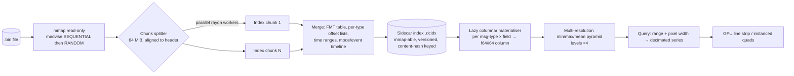

# 05 — Telemetry, Log Analytics & Diagnostic Engine

## 1. ArduPilot Dataflash `.bin` parser (`crates/logs`)

### 1.1 Format recap (what the parser must handle)
* Stream of records: `0xA3 0x95 <msgid:u8> <payload>`. Record length is defined by **FMT** messages (msgid 128): `type, length, name[4], format[16], labels[64]`. Self-describing: FMT records appear at the top of the log (and may repeat); **FMTU / UNIT / MULT** records add units and multipliers.
* Format characters (non-exhaustive): `b/B` i8/u8, `h/H` i16/u16, `i/I` i32/u32, `q/Q` i64/u64, `f` f32, `d` f64, `n/N/Z` fixed strings (4/16/64), `c/C` i16/u16 ×0.01, `e/E` i32/u32 ×0.01, `L` lat/lon i32 ×1e-7, `M` flight-mode u8, `a` i16[32]. The mapping table is code-generated from one place and unit-tested against fixture logs from each vehicle type and many firmware versions.
* Message timestamps are `TimeUS` (µs since boot) — not wall-clock; wall-clock derived from `GPS` (`GWk/GMS`), `SYSTEM_TIME`-equivalents or `BAT`-independent `TERR`… (we use GPS week/ms, fallback to log file mtime). Reboots inside one log are detected via `TimeUS` regressions → segments.
* Robustness: truncated tail records, corrupt bytes (resync by scanning for `0xA3 0x95` + known msgid + plausible length), unknown msgids, FMT redefinitions, very long logs (>4 GB — offsets are `u64`).

### 1.2 Pipeline

1. **Pass 1 – Index (fast, parallel).** Split the mapping into chunks; each worker finds the first valid record boundary, then walks records using the FMT table (FMT table is obtained from a quick serial pre-scan of the first MiB, plus any later FMT found). It stores only `(msgid, file_offset, time_us)` runs, not payloads: ~16 B/record → 4 GB ≈ 40–60 M records ≈ <1 GB worst case, so offsets are stored **delta-compressed per type** (≈2–3 B/record). Output: per-type offset vectors, time bounds, text/`MSG`, `MODE`, `EV`, `ERR`, `PARM`, `MSG` lists, and the sidecar file so re-opening is instant.
2. **Pass 2 – Lazy column materialisation.** The first time a plot requests `IMU[0].GyrX`, walk that type's offsets, decode the field into a contiguous `Vec<f64>` (or `f32` with flag) + `Vec<u64>` time column; cached in an LRU keyed by (type, instance, field) with a memory budget. Instance fields (`I` / `C` / `IMU[0]`) are split automatically.
3. **Pyramid for zoom.** Build min/max/mean levels (factor 4) lazily per column, so zooming/panning is O(visible pixels), independent of log size.
4. **Streaming mode.** For live download over MAVLink (`LOG_DATA`) the same parser consumes a growing file so plots can update while downloading; the partial tail is held back until complete.

Performance targets (M1, NVMe): index 4 GB ≤ 20 s (≥ 200 MB/s effective); column materialisation 10 M samples ≤ 150 ms; pan/zoom query ≤ 2 ms; 100 M-point series on screen at 60 fps.

### 1.3 Downsampling for rendering
* **Why:** the display has ≈ 3 000 horizontal pixels; drawing 10 M points wastes GPU and hides nothing.
* **Algorithm:** *LTTB* (Largest-Triangle-Three-Buckets, Steinarsson 2013) preserves visual shape; on its own it is O(n) per query and can miss narrow spikes (important for vibration/clipping and glitches). We therefore use **MinMaxLTTB**: per bucket pre-select min & max (from the pyramid, O(1)), then run LTTB over the 4× candidate set (`n_out = 2 × pixel_width`), guaranteeing extrema visibility *and* shape fidelity. Pyramid level chosen so that ≥ 4 source samples/bucket; below that, raw samples are drawn.
* **Rules:** time axis cached; decimation recomputed only when viewport changes (debounced to frame); decimated buffers are uploaded as persistent GPU vertex buffers; discrete signals (modes, events, booleans) use step rendering and are *never* LTTB'd.
* **Plot widget features:** shared time cursor across all plots/map/3-D, linked axes, multiple Y-axes with units, expressions (`sqrt(VibeX^2+VibeY^2+VibeZ^2)`, `degrees()`, `diff()`), mode/event/error annotations on the timeline, shaded regions, cursor stats (min/max/mean/stddev/integral), bookmark & share link, screenshots as PNG/SVG, saved plot presets (e.g., "EKF health", "Rate controller", "Battery") that adapt to field availability per firmware version.

### 1.4 Other log formats
| Format | Support | Notes |
|--------|---------|-------|
| `.bin` (ArduPilot Dataflash) | Full | primary |
| `.log` (text Dataflash) | Full | legacy |
| `.tlog` | Full | §3 |
| `.px4log`/ULog | Import-only (stretch) | not in parity scope |
| CSV/Parquet export | Yes | via Arrow |
| `.kmz/.gpx` | Export | §4 |

## 2. Automated health diagnostics

Rule engine = declarative **rule packs** (YAML, versioned with firmware generation, shipped as data; unit-tested with golden logs) evaluated over columns. Each rule returns `{id, severity(OK/INFO/WARN/FAIL), evidence(time ranges, values), explanation, remedy_link}` and is rendered as a clickable report whose items **jump to the offending time range in the plot**.

### 2.1 EKF (EKF2/EKF3)
| Check | Source (log msg/field) | Logic (default thresholds, configurable) |
|-------|-----------------------|-------------------------------------------|
| Innovation test ratios | `XKF4` (EKF3: `SV` velocity, `SP` position, `SH` height, `SM` mag, `SVT` airspeed) / `NKF4` (EKF2) | Ratio < 0.5 OK; 0.5–1.0 WARN (EKF near rejecting); >1.0 sustained > 1 s FAIL (innovation gate exceeded). The vehicle's `FS_EKF_THRESH` (default 0.8) is read from log `PARM` to annotate the failsafe margin |
| EKF health flags | `XKF4.SS` solution status bits, `EKF_STATUS_REPORT`(193) | Any loss of `pred_horiz_pos` / `const_pos_mode` / `using_gps` while armed → FAIL |
| Lane switches / resets | `XKF4.PI` (primary), `XKF3`/`XKFS` | >1 lane switch in flight → WARN; position/yaw resets count & magnitude |
| GPS glitch / jumps | `GPS` HDop, NSats, Status; `XKF*` | HDop > 2.0 → WARN; NSats < 6 → WARN; status < 3 while armed → FAIL |
| Compass-yaw consistency | `XKF3` mag innovations; `ATT.Yaw` vs GPS course | persistent yaw innovation → WARN |

### 2.2 Vibration & clipping
| Check | Source | Logic |
|-------|--------|-------|
| Vibration levels | `VIBE.VibeX/Y/Z` (m/s²) | Typical guidance: **< 15 good, 15–30 marginal (WARN), > 30 FAIL** (state of flight: only evaluate when armed & airborne). Per-axis stats + time series |
| Clipping | `VIBE.Clip0/1/2` (accumulating counters) | Any **increase** while armed → FAIL (if Δ > 0 during hover) with timestamp of first clip; count rate reported |
| Peak detection | raw IMU batch (`ISBH/ISBD`) or `IMU` gyro/accel at log rate | Welch PSD, find peaks > N× noise floor; map to motor RPM harmonics (RPM/ESC telemetry if present); recommend harmonic notch parameters (`INS_HNTCH_FREQ`, `_BW`, `_REF`, `_MODE`, `_HMNCS`) |
| Aliasing warning | log rate vs. needed Nyquist | Warn that low-rate IMU logging cannot assess >½ rate |

### 2.3 Compass / magnetic distortion
| Check | Source | Logic |
|-------|--------|-------|
| Field magnitude | `MAG[n].MagX/Y/Z` + offsets | `‖B‖` vs. expected local field (World Magnetic Model at GPS position); deviation > 35 % WARN, > 50 % FAIL |
| Motor interference | `MAG` vs `RCOU/BAT.Curr`/throttle | Correlation / regression of field magnitude change vs current; interference % of field: **< 30 % OK, 30–60 % WARN, > 60 % FAIL** |
| Multi-compass consistency | `MAG[0..2]` | Yaw difference between compasses > 30° WARN |
| Offsets sanity | `COMPASS_OFS*` | Offset magnitude > 600 mG WARN |
| Heading vs GPS course | `ATT.Yaw` vs GPS ground course when moving | persistent bias > 15° WARN |

### 2.4 Power & others
* **Battery:** voltage sag under load (`BAT.Volt` vs `Curr`, internal resistance estimate), cell-voltage imbalance (`BCL`), capacity used vs. remaining (`CurrTot`), low-battery failsafe events.
* **Board power:** `POWR.Vcc` outside 4.5–5.5 V WARN; `Vservo`; power flags.
* **Control quality:** `RATE`/`PIDR/PIDP/PIDY` tracking error (desired vs actual), oscillation detection (FFT peak on rate error), motor saturation/`MOT.ThO` near limits, `CTUN` altitude hold error.
* **Events:** `ERR` subsystem/code decoding (radio, failsafe, compass, EKF check, crash check, fence), `MSG` prearm failures, `MODE` timeline, `EV` arm/disarm.
* **Sensors:** IMU temperature drift, accelerometer consistency across IMUs, barometer vs. GPS altitude drift, rangefinder health (`RFND`).

Report output: HTML/PDF "Flight Health Report" (per DrorAero brand template) + machine-readable JSON, usable in CI (regression on SITL logs).

## 3. `.tlog` recording & synchronised playback

* **Format:** each record = 8-byte **big-endian µs-since-epoch timestamp** + raw MAVLink frame (v1/v2). Recorded **losslessly from the router before any decoding**, with file rotation per connection and crash-safe append (fsync at 1 s cadence).
* **Index:** background indexing builds time → offset checkpoints each 100 ms (seek O(log n)), per-message-type availability, key events (arm, mode, STATUSTEXT, mission item reached).
* **Playback engine:** `ReplaySource` implements the same `LinkSource` trait as a real link, so HUD, map, graphs, and diagnostics run unchanged in replay. Supports play/pause, scrub, speed 0.1×–32×, loop section, frame-step, bookmarks, jump-to-event; **stateful seek** replays the last known value of every message type up to T (a "keyframe" snapshot) so HUD is correct immediately after a seek. Command-sending is hard-disabled in replay mode (UI banner `REPLAY`).
* **Synchronised views:** one timeline controller broadcasts the clock to HUD, map (vehicle + trail), plots (cursor), 3-D replay, video (if recorded with sidecar), and message console.
* **Exports:** 
  * **CSV** (selected messages/fields, resampled option, SI units) — streaming writer.
  * **KML/KMZ** (track coloured by altitude/speed/mode, waypoints, extruded path, timestamps via `gx:Track`).
  * **GPX** (track + waypoints).
  * Also MAT, Parquet for data science; `.plan`/`.waypoints` extraction from logged mission.

## 4. Geotagging
* Inputs: image folder (EXIF `DateTimeOriginal`, `SubSecTime`), camera feedback from log (`CAM`/`CAMERA_FEEDBACK`), optional manual time offset.
* **Auto time-offset estimation:** correlate image time-series with trigger events (or with a distinctive attitude/altitude feature) via cross-correlation; present confidence and a preview map before writing.
* Interpolate position/attitude at each timestamp (Hermite on position, SLERP on attitude), write EXIF GPS + XMP (roll/pitch/yaw, relative altitude) non-destructively (copy or in-place with backup).
* Output reports: unmatched images, speed outliers, coverage map.

## 5. FFT / spectral analysis
* **Sources:** onboard batch sampler (`INS_LOG_BAT_MASK` → `ISBH/ISBD` raw blocks), high-rate IMU logging, plus the onboard `FTN1/FTN2` (gyro FFT) messages when enabled.
* **Offline algorithm:** detrend → Hann window → Welch averaged PSD (50 % overlap) via `rustfft`; spectrogram (STFT) with shared time axis; throttle-vs-frequency heat-map (to see motor-harmonic lines); peak finder; notch-filter designer showing the *before/after* attenuation curve of proposed `INS_HNTCH_*` values.
* **UI:** units in dB/Hz, log-log optional, linked cursor with time plot.

## 6. Data model & testing
* A single `Series` abstraction (time column, value column, unit, source) serves live telemetry, tlog replay and dataflash — so plots, diagnostics and exports are written once.
* **Test corpus:** ≥ 200 logs (all vehicle types, firmware 4.0→current, edge cases: truncated, reboot mid-log, multiple IMUs, high-rate logging, 4 GB+ synthetic generated by concatenation). Fuzzing, property tests (`parse(serialise(x)) = x`), differential tests against `pymavlink` `DFReader` and MAVExplorer for field equality on sampled records, and benchmark gates in CI (`/bench` with regression thresholds ±10 %).
