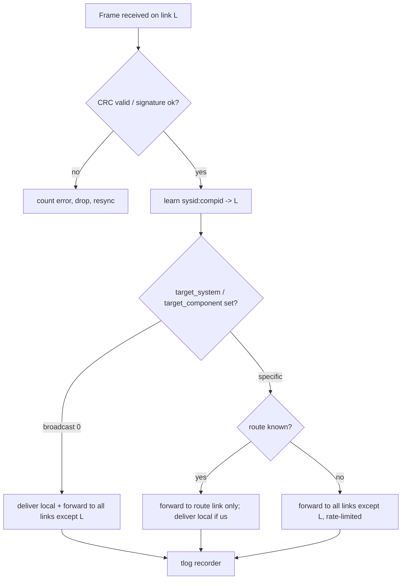

# 06 — Comprehensive Documentation Architecture & Specifications

**Principle: documentation is a product with owners, tests and release gates.** A feature is not "done" until its reference, handbook page, in-app help entry and (if architectural) ADR are merged. CI enforces this.

## 1. Documentation taxonomy (Diátaxis)

| Quadrant | Audience | Contents | Location |
|----------|----------|----------|----------|
| Tutorials | New devs / new operators | Guided first success (first build, first SITL flight, first mission) | `docs/tutorials/` |
| How-to guides | Devs, operators | Task recipes (add a MAVLink message handler, calibrate compass in the field) | `docs/howto/` |
| Reference | Devs, integrators | API, schemas, params, messages, CLI, config, error codes | generated + `docs/reference/` |
| Explanation | Architects | ADD, ADRs, rationale, threat model | `docs/architecture/`, `docs/adr/` |

## 2. Repository layout
```text
docs/
  architecture/            ADD (arc42), C4 diagrams, data-flow, threat model, performance budgets
  adr/                     NNNN-title.md  (MADR template), index auto-generated
  reference/
    core-api/              generated: rustdoc, protobuf/gRPC (buf + protoc-gen-doc), FFI header docs
    ui-api/                generated: Doxygen (C++/QML), qmldoc
    mavlink/               generated from XML: messages, enums, commands + ArduPilot behaviour notes
    parameters/            generated from ArduPilot metadata per firmware version
    errors/                DC-Exxxx / DC-Wxxxx catalogue (source of truth for in-app errors)
    cli/                   generated from clap definitions
  dev/                     onboarding, build, test, debug, release, style guides
  protocol/                routing flowcharts, dialect guide, link setup, pinouts, modem manuals
  handbook/                Operator handbook (pre/in/post-flight, emergencies, checklists)
  tutorials/ howto/
  contributing/ governance/ security/
mkdocs.yml  doxygen/  buf.yaml  vale/  lychee.toml
```

## 3. Toolchain (ADR-0007)
| Need | Tool | Why |
|------|------|-----|
| Site | **MkDocs Material** (+ `mike` versioning, `mkdocs-static-i18n`, `mkdocs-glightbox`, `mkdocs-mermaid2`) | Great search, offline build, versioned docs, Mermaid support |
| Rust API | `cargo doc` (+ `#![deny(missing_docs)]` on public crates, doctests executed in CI) | Compiles examples → they cannot rot |
| C++/QML API | Doxygen (XML) → `mkdoxy`/Breathe-style include; qmldoc | Matches Qt conventions |
| TypeScript (remote viewer/web tools, docs plugins) | TypeDoc | Typed API pages |
| gRPC/Protobuf | `buf` (lint + breaking-change detection) + `protoc-gen-doc` | Schema compatibility is a CI gate |
| MAVLink | In-house generator reading pinned XML (`all`, `ardupilotmega`) → Markdown pages with field tables and "routing & handling in DrorControl" annotations | Single source of truth |
| Diagrams | Mermaid + Structurizr/C4-PlantUML for C4; diagrams in-repo as text | Diffable |
| Prose quality | **Vale** (style guide: DrorAero tone — concise, rigorous, direct), markdownlint, codespell | Consistent voice per brand guide |
| Links | **lychee** | No dead links |
| Screenshots | UI test harness exports canonical screenshots (4 themes × OS) during doc build | Handbook never shows stale UI |
| Offline help | Build step creates a `help.bundle` (HTML + **SQLite FTS5**/Tantivy index) shipped in the app | Fully offline search |

## 4. Developer documentation

### 4.1 Architecture Design Document (arc42, living)
Sections: 1 Introduction & goals · 2 Constraints · 3 Context & scope (C4 L1) · 4 Solution strategy · 5 Building blocks (C4 L2/L3: this plan's [01](01-architecture.md) is the seed) · 6 Runtime view (sequence diagrams per key flow: connect, param download, mission upload, calibration, arm) · 7 Deployment view (per-OS packages) · 8 Cross-cutting (threading, error model, logging, i18n, security) · 9 Decisions (ADR index) · 10 Quality scenarios (perf budgets, tests) · 11 Risks · 12 Glossary.
The ADD is reviewed each phase gate; diagrams are generated from code where possible (crate dependency graph via `cargo-depgraph`, enforced by `cargo-deny`/`cargo-modules` layering rules).

### 4.2 ADR framework
* MADR format: *Title · Status (proposed/accepted/superseded) · Context · Decision drivers · Options (with scoring) · Decision · Consequences · Validation (spike/benchmark link) · Links*.
* Any change touching: crate boundaries, IPC schemas, dependency adoption, licence, platform entitlement, or safety interlocks **requires an ADR in the same PR** (CODEOWNERS + a PR-template checkbox + a CI check that scans for labelled paths).
* ADRs are immutable once accepted; supersede instead of edit. Index and status graph auto-generated.
* Seed ADRs 0001–0007 are in [`adr/`](adr/README.md).

### 4.3 API references (headless core & IPC)
* **Rust core**: rustdoc per crate, with a "stability" tag (`stable`, `unstable`, `internal`); examples are doctests; `cargo public-api`/`cargo-semver-checks` guard semver.
* **gRPC**: `proto/dc/v1/*.proto` fully commented; generated reference with RPC lifecycle diagrams (unary, streaming, cancellation semantics); `buf breaking` against last release; client SDK samples in Python/Rust/TypeScript compiled in CI.
* **FFI / C ABI**: header `dc_core.h` documented with ownership/threading/lifetime rules for every function; ABI version constant checked at load.
* **State & events schema**: JSON-Schema/FlatBuffers definitions for `TelemetrySnapshot`, `Event`, with field semantics, units, validity rules and update rates.
* **QML API**: every public component documented with `\qmltype` blocks and a live example in the component gallery.

### 4.4 Reproducible developer onboarding
Target: **new engineer builds, runs tests, and flies SITL in the UI in < 60 minutes**, checked by a quarterly "fresh machine" drill (and a CI job that runs the guide's commands in clean containers/VMs).

**macOS (Apple Silicon or Intel)**
```bash
xcode-select --install                       # Command Line Tools
/bin/bash -c "$(curl -fsSL https://raw.githubusercontent.com/Homebrew/install/HEAD/install.sh)"
git clone https://github.com/djdanou-cloud/drorcontrol && cd drorcontrol
brew bundle --file=packaging/macos/Brewfile  # qt@6 (pinned), gstreamer, cmake, ninja, just, protobuf, buf, doxygen, pkg-config, create-dmg
rustup show                                  # toolchain pinned by rust-toolchain.toml
just bootstrap && just build && just test
just sitl-copter && just run                 # downloads pinned SITL, launches app connected to it
```
**Linux (Ubuntu 22.04/24.04)**: `apt` list in `packaging/linux/deps.txt`, `rustup`, Qt via `aqtinstall` pinned version, `just bootstrap`.
**Windows 10/11**: `winget`/`scoop` manifest (`packaging/windows/deps.json`: VS Build Tools, Rust, Qt via aqt, GStreamer MSVC, CMake, Ninja, just), PowerShell `just` recipes.
**Hermetic option**: `devcontainer` / Nix flake / `docker compose run dev` for Linux headless core + docs + SITL; macOS and Windows UI builds use pinned toolchains via lockfiles.

### 4.5 Build, CI/CD and doc automation
```mermaid
flowchart LR
  PR[Pull request] --> L[Lint: clippy, rustfmt, clang-tidy, qmllint, vale, markdownlint]
  L --> B[Build matrix: macOS arm64/x86_64, Windows x64, Linux x64]
  B --> T[Unit + property tests, fuzz smoke]
  T --> S[SITL integration - headless]
  S --> UIT[QtQuickTest + golden screenshots]
  UIT --> D[Docs build: cargo doc, doxygen, buf, mavlink-gen, mkdocs --strict, lychee]
  D --> G{Gates: doc coverage, ADR check, parity.yaml diff}
  G -->|merge to main| P[Publish versioned docs via mike to Pages]
  G -->|tag| R[Release: ad-hoc sign + SHA-256 (ADR-0010), SBOM, docs bundle, appcast]
```
Gates: `mkdocs build --strict` warnings = failure; missing-doc lint on public items; `parity.yaml` rows that flip to *implemented* must reference a handbook page and test ID; broken link = failure; generated files verified up-to-date (`git diff --exit-code`).

### 4.6 Other developer docs
Coding standards (Rust API guidelines, C++ Core Guidelines subset, QML style), error-handling and logging guide (`tracing`, structured, no PII), threat model (STRIDE: serial/UDP injection, malicious logs/plans, plugin sandbox, update channel), security policy & vulnerability disclosure, release process, performance playbook, debugging guide (Instruments, `tracing-tracy`, Metal GPU frame capture), contribution guide, governance & code owners.

## 5. Avionics & protocol integration guide (`docs/protocol/`)

1. **MAVLink message routing schemas** — generated from the router config: diagrams of endpoint ↔ (sysid, compid) tables, which messages are forwarded/filtered, learned-route aging, loop-prevention. A flowchart per direction:



2. **Dialect extension guide**: add custom messages/commands (ID ranges: MAVLink "user" ranges), XML authoring, generator invocation, versioning rules, handling `incompat_flags`, extension fields, test fixtures, doc-page generation, how to expose in the UI.
3. **Message catalogue pages** (per message): fields, units, rate defaults, who sends/consumes, DrorControl handling, known firmware quirks (e.g. `STATUSTEXT` chunking, `PARAM_VALUE` ordering, `MISSION_ITEM_INT` frame semantics).
4. **Hardware connection manuals**
   * **Autopilot ports:** `SERIALn_PROTOCOL/BAUD` tables, pinouts for common FCs (Cube/Pixhawk 6X/Matek/Kakute), JST-GH wiring, power budgets, voltage levels.
   * **Telemetry radios:** RFD900x/RFD900ux (SiK AT config, `NETID`, air-rate, TX power legal limits per region), Holybro/3DR SiK 433/915 MHz, wiring to FC TELEM ports, ground-side USB, range/antenna guidance.
   * **ExpressLRS / Crossfire:** MAVLink telemetry over CRSF/ELRS backpack and ground-side bridging, required `SERIALn` configs, bandwidth caveats and recommended stream rates, tested firmware versions.
   * **IP links:** Ethernet/Wi-Fi/cellular/radio-modem UDP/TCP topologies, default ports (UDP 14550 GCS, TCP 5760 SITL), NAT/VPN, multicast, MTU/latency tuning, MAVLink signing for IP links.
   * **Peripherals:** RTK base/rover + NTRIP, ADS-B receivers (uAvionix/PingRX), antenna tracker, cameras/gimbals, companion computers (MAVProxy, mavlink-router).
   * Each manual has a **verified-hardware table** (model, firmware, date, tester) updated from the HITL bench ([08](08-safety-vv.md)).

## 6. End-user Flight Operations Manual (`docs/handbook/`)

Illustrated, task-oriented, versioned with the app; PDF (print/brand-styled, A4/Letter) and web/in-app formats built from one source. Written in the DrorAero voice: concise, directive, no fluff.

| Part | Chapters |
|------|----------|
| 0 Orientation | Safety principles, roles, terminology, symbology key (PFD, map, annunciators), how the UI is organised |
| 1 Preparation | Installation per OS, first connection, vehicle setup flow, calibrations, failsafe design, geofence & rally, mission planning for survey/SAR/inspection, regulations disclaimers |
| 2 **Pre-flight** | Pre-flight checklist (embedded as interactive in-app checklist), link test, GPS/RTK readiness, prearm resolution table, battery & weight, weather/wind, terrain readiness, arming procedure |
| 3 **In-flight** | Takeoff, monitoring (what “normal” looks like), mode usage, guided operations, mission changes in flight, camera/gimbal ops, handling warnings (decision tables), link degradation procedure, RTL/Land |
| 4 Emergencies | Lost link, GPS loss, EKF failsafe, battery critical, fly-away, motor failure, geofence breach, fire/battery venting, kill switch policy — each as a one-page QRH-style card |
| 5 **Post-flight** | Disarm & power-down, log download, auto-analysis review, maintenance triggers (vibration/clipping/compass), data archival, debrief template |
| 6 Maintenance & tuning | Parameter management, tuning workflow, firmware update, backup/restore |
| 7 Appendices | Parameter quick reference, error-code catalogue, keyboard & gamepad maps, glossary, troubleshooting trees, regulatory/export notice |

Standards: each procedure has *Purpose · Preconditions · Steps (numbered, one action each) · Expected result · If not · Related alarms*; screenshots auto-generated (§3); every safety-critical chapter reviewed by a test pilot and recorded in a sign-off table; translations (Hebrew first, RTL layout verified) driven by `mkdocs-static-i18n`.

## 7. In-app contextual help system
* **Offline help engine:** `help.bundle` (SQLite FTS5) containing handbook pages, parameter docs for the connected firmware version, error catalogue, and protocol notes. Search-as-you-type (<30 ms), typo-tolerant, filters by vehicle/phase.
* **Deep links** by stable IDs: `param:ATC_RAT_RLL_P`, `err:DC-E1042`, `msg:STATUSTEXT/PreArm: Compass not calibrated`, `ui:setup/compass`, `cmd:NAV_WAYPOINT`. 
* **Contextual surfaces:** `?` button on every panel (opens side drawer at the right section); hover/long-press tooltips from metadata; STATUSTEXT console rows with “Explain” → matched via regex patterns table (`prearm_messages.yaml`: pattern → cause → fix → link); error dialogs always include a code and "What now?" action.
* **Guided procedures:** step-by-step overlays (coach marks) for setup wizards, driven by the same procedure definitions as the handbook (single source → no divergence).
* **Update path:** help bundle versioned by app + firmware metadata; delta updates over the app updater; works with zero connectivity.
* **Telemetry-free feedback:** “Was this helpful?” stored locally, exportable by the user; no network by default.

## 8. Documentation quality KPIs
Doc coverage of public APIs 100 %; parity rows with handbook page 100 % at GA; onboarding drill ≤ 60 min; 0 broken links; search success rate (usability tests) ≥ 90 %; handbook procedures validated by test-pilot dry-run each release; docs site Lighthouse/a11y ≥ 95.
