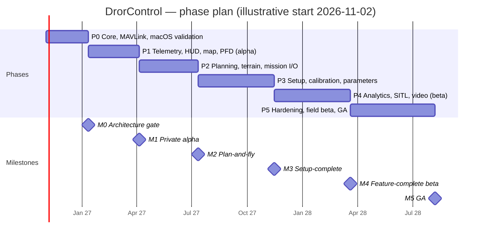

# 07 — Project Phasing, Milestone Roadmap & Team Topology

Cadence: **2-week sprints**, quarterly planning, a **phase gate** at the end of every phase (go / re-plan / stop) with objective exit criteria. Assumed kickoff: **Mon 2026-11-02** (illustrative). Estimates are ±30 % and re-baselined at the Phase 0 gate once real velocity exists.

## Phase summary

| Phase | Sprints | Weeks | Avg FTE | Person-weeks | Calendar (from kickoff) |
|-------|--------:|------:|--------:|-------------:|-------------------------|
| P0 Foundation | S1–S5 | 10 | 8 | 80 | M0–M2.5 |
| P1 Telemetry/HUD/Map | S6–S11 | 12 | 12 | 144 | → M5.5 (**alpha**) |
| P2 Planning | S12–S18 | 14 | 15 | 210 | → M8.8 |
| P3 Config/Calibration | S19–S27 | 18 | 18 | 324 | → M13 |
| P4 Analytics/SITL/Video | S28–S36 | 18 | 19 | 342 | → M17 (**beta**) |
| P5 Hardening/GA | S37–S46 | 20 | 18 | 360 | → M21.5 |
| **Total** | **46** | **92** | | **1 460 (~28 person-years)** | **~21.5 months + ~10 % contingency ≈ 23 months** |

## Phase 0 — Core Architecture, MAVLink Engine & macOS Driver Validation (S1–S5)
**Goal:** retire the top technical risks and make the walking skeleton: *connect → heartbeat → parameters → one signed, notarized macOS build in CI.*

Deliverables
* D0-1 Repo, monorepo layout, `just`/`xtask`, CI on macOS arm64/x86_64, Windows, Linux; hermetic toolchains.
* D0-2 `mavlink-codec` (generated dialect, v1/v2, signing), `mav-router`, serial/UDP/TCP links, tlog recorder; fuzz targets.
* D0-3 Core daemon + gRPC + `core-ffi`; `dc-cli` (connect, list params, dump telemetry).
* D0-4 **macOS validation matrix**: IOKit enumeration/hotplug, baud tests, CDC/FTDI/CP210x/CH340 across macOS 13–26 and arm64/Intel ([03](03-macos-platform.md)); decide on CP210x fallback driver need.
* D0-5 Spikes S0-1…S0-6 ([01 §9](01-architecture.md)) with written results → ADRs.
* D0-6 Notarized universal "hello GCS" build; Apple multicast entitlement request filed; Developer ID + ASC key provisioned.
* D0-7 **Parity audit** → frozen `parity.yaml`; test-corpus collection (logs, plans, params) with consent/licensing.
* D0-8 Design system v0 (tokens, type, 4 themes), UX research plan, brand font licence resolved.
* D0-9 Docs skeleton live: MkDocs site, ADR template, generated MAVLink reference, onboarding guide v0.

Exit criteria: all spikes pass or have an approved alternative; 30-min soak on 3 serial chips with 0 CRC errors; ad-hoc signed universal build with checksums installs and launches on a fresh macOS machine, first launch (Open Anyway) checked once by hand (restated by ADR-0013: no Apple credentials, ADR-0010); plan re-baselined.

## Phase 1 — Basic Telemetry, HUD, Moving Map & PFD (S6–S11) → **M1 private alpha**
* Vehicle state store; Copter/Plane/Rover/Sub/Tracker profiles; stream-rate negotiation; link health HUD.
* Vector **PFD** + gauges + messages + status + Quick tab; TTS annunciators; unit system.
* Moving map (chosen `MapSurface`), vehicle/trail/home, offline tile cache v1, trackpad gestures.
* Safe command set v1: arm/disarm, mode change, RTL, land, takeoff, guided go-to (with interlocks, audit log).
* `.tlog` record/replay v1; MAVLink inspector; docking workspaces; theme switcher.
* Docs: operator handbook skeleton (connect/fly view), component gallery, perf dashboards.
* Radio link track, Steps 1–2 ([below](#radio-link-track-expresslrs-and-crossfire)): link profiles (Full / High / Constrained-ELRS) with per-link adaptive stream rates; link-quality HUD (LQ/RSSI/SNR with source, DEGRADED state).
Exit: 60 fps on reference Macs; 200 k msg/s burst without frame drops; 3 field sessions with test pilots on real vehicles; SUS ≥ 70.

## Phase 2 — Flight Planning, Terrain Following & Mission Upload/Download (S12–S18) → **M2**
* Mission model + transactional upload/download/verify state machine; full `MAV_CMD` catalogue with typed editors (generated from metadata).
* Waypoint/spline/loiter, undo/redo, file I/O (`.waypoints`, `.plan`, KML, CSV).
* Geofence, rally; **offline SRTM/Copernicus DEM**, profile view, terrain frame support, `TERRAIN_REQUEST/DATA` service, terrain readiness check.
* Survey grids, corridor, SAR patterns, camera DB, trigger/gimbal calculation; mission lint; 3-D view (`wgpu` terrain draping).
* Mission statistics/energy model; simulation scrubber.
Exit: round-trip fidelity (upload→download byte-equal semantics) across a golden mission corpus on SITL for all vehicle types; survey math validated against analytic cases and reference tool outputs; usability: median time to build a 20-WP survey mission ≤ target set from legacy benchmark.

## Phase 3 — Vehicle Configuration, 3-D Calibrations & Full Parameter Management (S19–S27) → **M3**
* Parameter engine (download/cache/search/diff/write verify/risk labels/help), metadata service.
* Firmware flasher (bootloader proto, DFU, APJ, manifest, DroneCAN update) — **hardware-gated** (HITL bench).
* Accel/compass/radio calibration wizards with 3-D models; motor test + ESC cal; flight-mode & failsafe matrix; battery/sensor setup; SiK radio config; servo outputs; OSD editor; terminal.
* Basic/extended tuning; MAVFTP; Lua script manager; vehicle config wizards (copter/plane/rover/sub/tracker).
* Localisation framework + Hebrew/RTL pass 1; accessibility pass 1.
* Radio link track, Step 3: `crsf-codec` (CRSF frames, CRC-8/DVB-S2, telemetry and RC packing) and the link `Framer` seam.
Exit: new-vehicle-to-first-flight workflow completed unaided by 5 of 5 novices in usability tests; parameter table latency budgets met; firmware flashing success ≥ 99 % across the bench board list (≥ 12 boards), with no bricks.

## Phase 4 — Dataflash/Tlog Analytics, SITL Integration & Video Streaming (S28–S36) → **M4 feature-complete beta**
* Dataflash parser/index/plots; diagnostics rule packs; FFT; geotagging; exporters; log download (MAVLink + FTP).
* SITL manager (all vehicle types, wipe, speed-up, wind, fail-injection hooks); headless scenario runner polished for CI use by third parties.
* Video: GStreamer pipeline, HW decode on all OS, overlay sync, recording, MAVLink camera/gimbal protocol; PiP and multi-stream.
* NTRIP/RTK, ADS-B, antenna tracker routing, joystick/gamepad (`GameController`/XInput/SDL), Bluetooth, follow-me, plugin/scripting API, airspace layers.
* Docs: complete protocol/hardware guide with verified-hardware tables; handbook all parts drafted.
* Radio link track, Step 4a: CRSF TX-module serial link, receive only (telemetry and link statistics). Gamepad-to-CRSF RC output (4b) is *later*, after 1.0 (owner 2026-10-15).
Exit: **100 % parity rows implemented** (verified by `parity.yaml` dashboard); 4 GB log budgets met; 1080p video budget met; public beta channel open.

## Phase 5 — Hardening, Automated SITL Flight Testing, Field Beta & Production Release (S37–S46) → **M5 GA**
* Automated SITL flight regression (nightly + per-PR smoke), chaos/lost-link suites, soak (72 h connected), memory/handle leak tests, long-run battery tests.
* Field beta programme (≥ 25 operators, ≥ 500 flight hours, mixed OS/hardware), telemetry-free feedback loop, triage SLAs.
* Performance and power tuning; accessibility & i18n completion; security review + external pentest; SBOM, licence audit; installers (DMG/MSI/MSIX/AppImage/Flatpak), auto-update (Sparkle/WinSparkle), crash reporting (opt-in).
* Handbook finalised, translated (Hebrew), reviewed by test pilots; in-app help bundle validated; training material.
Exit (GA gate): zero open Sev-1/Sev-2; parity 100 % implemented/tested/documented; no regressions vs. SITL golden flights; notarization/signing pipeline proven on 3 consecutive releases; V&V sign-off ([08](08-safety-vv.md)).

## Radio link track: ExpressLRS and Crossfire

Official support for ExpressLRS (ELRS) and TBS Crossfire (CRSF) links, planned in
[09](09-elrs-crsf-support.md). It is added *inside* existing phases. It changes **no**
milestone, exit criterion or parity row: its rows are in the parity matrix's "beyond Mission
Planner" section ([02 §H](02-parity-matrix.md#h-beyond-mission-planner-par-ext)), which the M4
parity gate does not count.

| Step | Track | Phase / milestone | Needs |
|------|-------|-------------------|-------|
| 1 Link profiles (Full / High / Constrained-ELRS) and adaptive stream rates | 1 Constrained-bandwidth MAVLink | P1 → M1 | SITL `sim:ELRS` |
| 2 Link-quality HUD and signal telemetry | 1 (and 2 once Step 3 lands) | P1 → M1 | SITL; UI shell |
| 3 CRSF codec with unit, property and fuzz tests | 2 Native CRSF | P3 → M3 | none |
| 4a TX-module serial driver, receive only | 2 | P4 → M4 | HIL bench with ELRS modules (Crossfire later) |
| 4b Gamepad-to-CRSF channels (DrorControl as the transmitter) | 2 | *later*, after 1.0 | owner and safety-lead sign-off, ADR |

Estimate: about 4 person-weeks in P1 (core and HUD), 3 in P3, and 3 in P4 including the bench (4b is not counted).
That is inside each phase's contingency, so no re-baseline is needed. Owner: WS-MAVLINK, with
WS-UI (HUD), WS-MACOS/WS-PLAT (serial) and, for the later Step 4b, WS-SAFETY.

## Team topology & resource allocation

Stream-aligned squads with enabling/platform teams (Team Topologies). Peak ≈ 22 people (incl. part-time).

| Role | Count (peak) | Responsibilities |
|------|-------------:|------------------|
| Principal architect / tech lead | 1 | ADRs, cross-cutting design, phase gates |
| **Core systems engineers (Rust)** | 5 | codec, router, state store, protocols (params/mission/log/ftp/cal), logs engine, gRPC |
| Protocol & firmware integration engineer | 2 | ArduPilot behaviours/quirks, metadata pipeline, bootloader/flasher, SITL harness |
| **macOS / platform specialist** | 2 (+1 Win/Linux platform) | IOKit/serial/hotplug, GameController, entitlements, signing/notarization, power; Windows (SetupAPI, MSIX) & Linux packaging |
| UI engineers (Qt/QML/C++) | 4 | shell, docking, models, panels, wizards, i18n/RTL |
| Graphics engineers (GPU/wgpu/RHI) | 2 | PFD, plots, map integration, 3-D scene, video compositing |
| **Aerospace UX designer(s)** | 2 (lead + researcher/motion) | Design system, PFD, usability research, human-factors review |
| Technical writers | 2 | Handbook, protocol guides, in-app help, docs tooling |
| **QA / SDET** | 3 | Automation, SITL/HITL rigs, UI/golden tests, release qualification |
| **Test pilots (contract/part-time)** | 2 | Field validation, procedures, handbook sign-off |
| DevOps / release engineer | 1 | CI/CD, runners, signing, docs publishing |
| Product manager / program lead | 1 | Roadmap, parity governance, beta programme |
| Safety / V&V lead (part-time → full in P5) | 1 | Hazard analysis, requirements traceability, V&V plan |

FTE ramp: 8 → 12 → 15 → 18 → 19 → 18 (see table above). Hiring plan: Core + macOS + architect + UX lead before kickoff; UI/graphics by S3; QA/DevOps by S4; writers by S6; test pilots from P1 (monthly), weekly in P4–P5.

## Sprint cadence template
| Day | Activity |
|-----|----------|
| W1 Mon | Sprint planning; capacity incl. hardware-bench time |
| Daily | 15-min stand-up per squad; trunk-based development, PRs ≤ 400 LoC, feature flags |
| W1 Fri | Architecture office hours (ADR clinic) |
| W2 Wed | Cross-squad demo to test pilots (on real hardware where possible) |
| W2 Fri | Review/retro; parity dashboard + perf dashboard review |

Definition of Done: code + tests + docs (reference, handbook, in-app help) + parity row updated + accessibility/i18n checked + perf budget not regressed + security checklist.

## Top risks & mitigations
| # | Risk | P | I | Mitigation / trigger |
|---|------|---|---|----------------------|
| R1 | MapLibre-Metal↔Qt RHI interop fails | M | H | Gate S0-3 week 6; `wgpu` map fallback (+10 pw reserved) |
| R2 | `cxx-qt` instability | M | M | Own stable `core-ffi`; C++ adapter fallback |
| R3 | Hidden Mission Planner features not captured | H | M | D0-7 audit, beta users' diff reports, parity dashboard |
| R4 | Firmware flasher bricks boards | L | H | Bootloader-only flashing paths, HITL matrix, checksum + readback, staged rollout |
| R5 | macOS release/notarization breakage (Apple policy changes) | M | M | Nightly dry-run signing; fallback manual notarization runbook |
| R6 | Local-network/multicast entitlement delay | M | L | Early request; unicast fallback |
| R7 | CP210x/CH340 driver gaps on some macOS | M | M | Phase 0 matrix; user-space fallback |
| R8 | Licence/IP issues (GPL contamination; font settled: Inter, OFL) | M | H | Clean-room policy, legal review at M0, SBOM + licence scanner in CI |
| R9 | Scope creep beyond parity | H | M | Parity governance board; “won't” list needs ADR |
| R10 | Safety-relevant bug in command path | L | H | Single command pipeline, interlocks, mandatory SITL scenarios, independent review, field-beta restrictions |
| R11 | Hardware/bench availability | M | M | Procure bench by S3; remote-accessible rigs |
| R12 | Estimate error ±30 % | H | M | 10 % contingency + phase-gate re-baselining; MoSCoW within parity rows |
| R13 | ELRS/Crossfire behaviour differs from source reading (closed Crossfire firmware; ELRS changes between 3.x and 4.x) | M | M | Facts pinned to versions in [09 §2](09-elrs-crsf-support.md#2-verified-facts); HIL checklist per firmware; SITL `sim:ELRS` scenario in CI |
