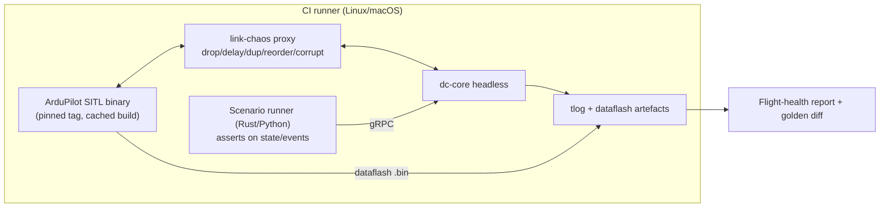
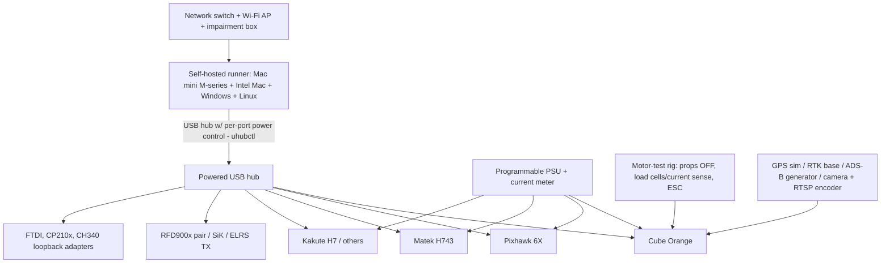
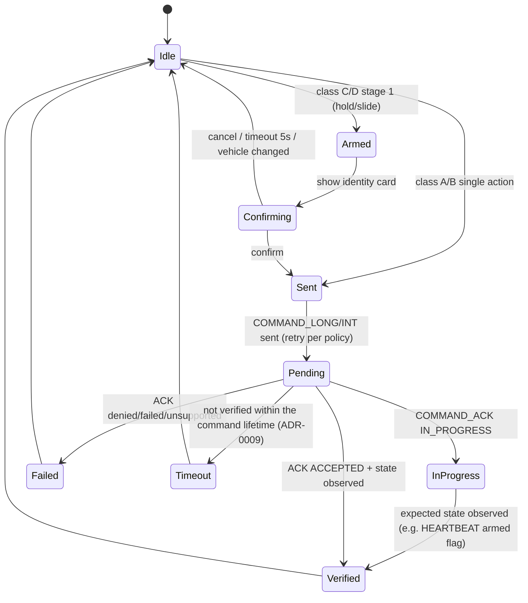

# 08 — Safety, Verification & Validation Protocol

Scope note: this GCS is not a certified avionics product (it is not DO-178C-certified). It **adopts DO-178C/ARP4754-inspired practices** (hazard analysis, requirements traceability, independent verification) for the *command path* and *safety-relevant displays*, because a GCS defect can cause or contribute to loss of a vehicle. Hazard analysis is maintained in `docs/safety/hazards.md` (FHA/FMEA-lite) and reviewed each phase gate.

## 1. Hazards driving requirements (excerpt)
| ID | Hazard | Causes | Controls |
|----|--------|--------|----------|
| H1 | Unintended terminal command (in-flight disarm, kill, reboot, force-arm) | Mis-click, wrong vehicle, key shortcut, joystick button, script | Two-stage confirm for terminal actions only (ADR-0011), vehicle identity echo, plugin permissions; accidental single-action flight commands are H14 in the hazard log |
| H2 | Wrong vehicle commanded | Multi-vehicle, stale selection | Persistent colour+name banner; confirm dialog shows sysid/name/colour/position |
| H3 | Stale data shown as live | Link loss, freeze, parser stall | Per-field age, invalidation flags, link state machine, watchdog |
| H4 | Mission corrupt/partial upload | Packet loss, abort | Transactional transfer, readback verification, draft≠vehicle badge |
| H5 | Dangerous parameter change | Typo, imported file, batch | Risk labels, diff preview, typed confirmation, auto-snapshot/rollback |
| H6 | Calibration error giving bad sensor data | Wrong orientation | Guided 3-D wizard, fitness thresholds, post-cal sanity checks |
| H7 | Motor spins unexpectedly | Motor test with props | Prop-off attestation, armed-state lockouts, throttle cap, timeouts |
| H8 | GCS freeze / crash during flight | Bug, memory, GPU hang | Process separation (core daemon survives UI crash), watchdog, auto-reconnect, no loss of recorder |
| H9 | Alert fatigue / missed alert | Too many annunciations | Priority model, rate limiting, audio+visual redundancy |
| H10 | Compromised link/plugin | Spoofed MAVLink, malicious script | Signing, plugin sandbox & permissions, input validation |

The full log for the operational profile (MIL-STD-882E; H1–H18, risk targets, safety
requirements) is [`docs/safety/hazards.md`](../safety/hazards.md).

## 2. Automated SITL testing pipeline (headless, in CI)

### 2.1 Architecture

* SITL built from pinned ArduPilot release tags (Copter, Plane, Rover, Sub, Tracker) plus *latest-stable* and *master* canaries (allowed to fail, tracked) — catches upstream changes early.
* **Scenario DSL** (YAML + Rust/Python hooks): `given vehicle=copter, location=…; when upload(mission.plan), arm, mode(AUTO); expect(reached(wp=3) within 120s); inject(link.loss for 15s); expect(event(FAILSAFE_GCS) ∧ mode==RTL)`.
* **Mandatory scenario suites**
  | Suite | Cases |
  |-------|-------|
  | Connect | all transports; v1/v2; signed link; wrong baud; multi-vehicle; reconnect after drop |
  | Parameters | full download with 30 % loss (must complete), set/readback, bitmask/enum, reboot-required, interrupted batch rollback, compare/diff correctness |
  | Mission | upload/download/clear round-trip for every supported `MAV_CMD`; fence + rally; resume after interruption; duplicate/out-of-order requests; `MISSION_ACK` error codes; terrain-frame missions with `TERRAIN_REQUEST` service |
  | Flight | arm → takeoff → AUTO survey → RTL → land → disarm for each vehicle; mode changes; guided goto; speed/alt change; pause/continue |
  | Failsafe & lost link | GCS-link loss (`FS_GCS_ENABLE`), RC loss, low battery, EKF, fence breach, terrain loss; verify GCS UI states (link degraded → lost → recovered) and no stale display |
  | Calibration | accel/compass flows against SITL’s simulated cal support; failure branches |
  | Logs | download over MAVLink and MAVFTP, resume, erase; tlog record/replay equality |
  | Robustness | 200 k msg/s flood, malformed frames fuzz replay, 72 h soak (weekly), memory/FD leak detection |
* **Determinism:** SITL speedup ×N with time-aware assertions; seeds recorded; flakes quarantined only with a ticket and an owner (never silently retried to green).
* **Per-PR smoke (≤ 12 min), nightly full (≤ 3 h), weekly soak + latest-ArduPilot canary.**

### 2.2 Other automated layers
| Layer | Technique |
|-------|-----------|
| Unit | `cargo test`, property tests (`proptest`) on codec, mission/param state machines, geodesy, survey math |
| Fuzz | `cargo-fuzz` (MAVLink frames, dataflash, tlog, plan/KML/param parsers), run continuously (OSS-Fuzz-style) |
| Differential | vs. `pymavlink` for parsing and CRC; vs. reference tools for survey/footprint calculations |
| UI | QtQuickTest, accessibility tree assertions, **golden-image screenshots** (PFD, map, wizards) × 4 themes × 3 DPI with tolerance; layout under RTL |
| Performance | `/bench` regression gates (ingest, parse, plot, frame time, power) ±10 % |
| Static/security | clippy `-D warnings`, `cargo-deny/audit`, clang-tidy, CodeQL, SBOM (CycloneDX), secret scanning |
| Packaging | install/upgrade/uninstall on clean VMs; Gatekeeper first-run procedure (ADR-0010 "Open Anyway"); ad-hoc signature + checksum verification |

## 3. Hardware-in-the-loop (HITL) test bench

* **What runs on hardware nightly:** USB hotplug/replug cycles (1 000×), baud sweep, bootloader entry + firmware flash + verify + boot (each board, each OS), parameter full-sync timing, motor-test lockouts (props-off rig), calibration flows with a servo-driven orientation jig (or IMU-injection), RC calibration with a PPM/SBUS generator, telemetry-radio range-free configuration, video latency measurement (LED-to-screen test), RTK/NTRIP with recorded caster stream, controller input injection (HID emulator).
* **Safety rules for the lab:** props removed always; interlocked enclosure for motor rig; battery fire protocol; written test-pilot sign-off for any tethered/outdoor test.
* **Field qualification:** each release candidate flown by test pilots across ≥ 4 vehicle types (copter, plane, rover, sub/tracker where available) following the handbook procedures; flight logs auto-analysed and attached to the release record.
* **Verified-hardware table** in docs is generated from bench results.

## 4. UI safety interlocks

### 4.1 Command classification
| Class | Examples | Pattern |
|-------|----------|---------|
| **A – Benign / reversible** | change map layer, select vehicle, open dialogs | none |
| **B – Flight control (single action)** | **every mode change** (any mode, incl. Auto/Guided/Acro, VTOL Q-modes), **RTL**, **Land**, **Arm**, **Takeoff**, guided go-to, change speed/alt, set current WP, camera trigger, **motor test** (bench; lockouts below) | One action — click, hotkey or hardware switch — sends the command **when the input event arrives**: no hold timer, no card, no animation gate. Visible pending → ACK → verified; a mode change that is not confirmed within its 2–3 s lifetime is dropped and the pilot alerted |
| **C – Terminal (two-stage)** | **In-flight motor disarm**, **emergency motor termination** (force-disarm), **autopilot reboot**, parameter reset, firmware flash, mission upload while armed | Stage 1: slide (or press-and-hold). Stage 2: confirmation card with vehicle identity (name/sysid/colour/mode/armed state), exact action, consequence; explicit button (not default-focused); 5 s auto-cancel; Esc cancels. No typed text |
| **D – Hazardous configuration** | Force-arm (bypass pre-arm checks), disable arming checks, disable failsafes, calibration overwrite | C + typed confirmation (vehicle name), reason logged |

*Speed vs. safety* ([ADR-0011](adr/0011-operational-profile-and-command-classes.md), Flight Operations & Systems Safety Lead, 2026-10-11, superseding v1 of this table): for this profile (MIL-STD-882E, BVLOS maritime/remote, 1:1 professional crews) **delayed control is itself a Critical hazard**, so every flight control, above all mode changes as the primary arrest manoeuvre, is single action. Two-stage confirmation is reserved for actions that end the flight or cannot be undone. Emergency motor termination may also use a configured physical switch, routed through the same two-stage pipeline.

### 4.2 Command lifecycle (single pipeline for UI, joystick, scripts)

* **Verification is state-based**, not ACK-based: “ARMED” is shown only when `HEARTBEAT.base_mode` confirms; otherwise show `ARM — NOT CONFIRMED`.
* Interlocks are enforced in the **core** (not just the UI): `CommandPolicy` sends class B at once and rejects class-C/D commands lacking a valid, recent, vehicle-bound confirmation token → scripts/plugins/gRPC clients cannot bypass; headless CI uses a test policy with explicit tokens.
* Context lockouts: motor test only when known disarmed and after prop-off attestation (all vehicle types); param reset and autopilot reboot blocked while armed; mission upload while armed requires class-C and is blocked for non-Guided/Auto-compatible modes; firmware flash blocked if any link active to other vehicle.
* **Audit log:** append-only (hash-chained) record of every command, confirmation, parameter write, and outcome with time, user profile, vehicle, link — exportable and included in flight reports.
* **Joystick safety:** deadman button, neutral-on-start check, zero-stick on disconnect, controller-active indicator; joystick/hardware switches fire class B (mode, RTL, Land) as single actions through the same pipeline and can never trigger class C/D without the same two-stage UI.

### 4.3 Degraded communications — explicit UI states
| State | Definition (defaults) | UI | Behaviour |
|-------|-----------------------|----|-----------|
| **CONNECTED** | HEARTBEAT < 1.5 s, loss < 5 % | Normal | Commands sent normally |
| **DEGRADED** | loss 5–30 % or latency > 500 ms or RSSI/rem-RSSI low | Amber banner `LINK DEGRADED`, link quality widget pulses | Commands sent with adaptive retry ([ADR-0009](adr/0009-link-state-never-blocks-commands.md)); confirmation card shows link quality; param/mission transfers warn |
| **STALE** | No HEARTBEAT 1.5–5 s | Instruments dim; values show age; amber `NO DATA 2.1s` | Commands **still sent**, retransmitted until ACK/verified or lifetime expires; card and ribbon show `NO DATA 2.1s` and “may not arrive” |
| **LOST** | No HEARTBEAT > 5 s | **Red** `LINK LOST` + audio + last-known position marker with age; instruments flagged invalid (X); map shows predicted position cone | Commands **still sent** (all links, retransmitted, bounded lifetime); what the vehicle will do (from `FS_GCS_*`) displayed; reconnect assistance |
| **REPLAY** | Source is log | Blue/cyan `REPLAY` watermark | Command path hard-disabled |
| **SIM** | SITL flag in vehicle/SYSID or user-set | `SIM` badge | Same code path, but clearly labelled |
**Link state never blocks, delays or drops a confirmed command** ([ADR-0009](adr/0009-link-state-never-blocks-commands.md), product-owner decision 2026-10-11): heartbeat loss is not proof the uplink is down, and locking the operator out of recovery is the greater hazard. Link state informs (card, ribbon, failsafe preview) and adapts delivery (retransmit on every link until `COMMAND_ACK` or verified state); every command has a bounded lifetime (default 30 s RTL/Land, 2–3 s mode change, 10 s others; ADR-0011), is superseded by a newer conflicting command, and is reported `SENT — NOT CONFIRMED` until verified or `EXPIRED`. Only REPLAY has no command path (no vehicle).

Thresholds are user-configurable within safe bounds and stored per link profile (for ExpressLRS / Crossfire links, LQ and RSSI thresholds and the source of each value: [09](09-elrs-crsf-support.md) Step 2); transitions are logged and announced. A **watchdog** on the UI frame loop and on the core’s ingest loop raises `GCS SOFTWARE FAULT` banner if either stalls > 500 ms (UI) / > 2 s (ingest).

### 4.4 Other UI safety rules
* No modal dialog may obscure the PFD’s critical annunciations; confirmation cards are anchored beside, not over, them.
* Prearm failures are always visible near the ARM control with direct remedy links.
* Defaults are safe: failsafe templates ship with conservative values; dangerous features (disable arming checks, kill) hidden behind an “Advanced” profile.
* Every irreversible action has a pre-action summary and, where possible, an automatic backup (params snapshot, mission download before overwrite).

## 5. Traceability & release qualification
* Requirements (parity rows + safety requirements `SR-nnn`) ↔ tests ↔ docs matrix generated in CI.
* Release checklist: all SITL suites green on pinned + latest firmware; HITL matrix green; field flights with logs; security scan; licence/SBOM; docs gates; independent V&V reviewer sign-off; rollback plan and staged rollout (5 % → 25 % → 100 %) with kill-switch to halt updates.
* Post-release: incident process (defect → hazard log update → regression test added before fix is merged).
