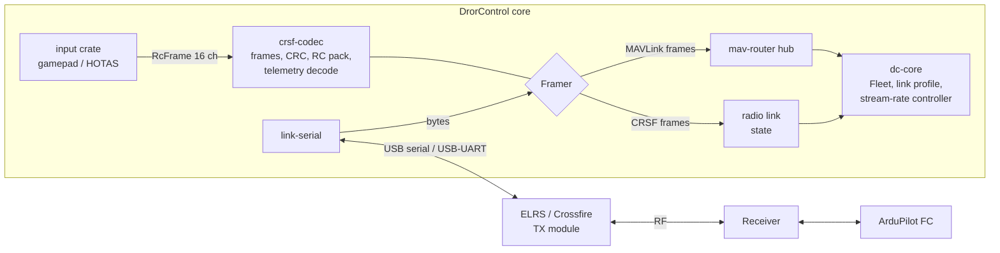

# 09 — ExpressLRS and Crossfire (CRSF) link support

> Status: **plan; owner decisions of 2026-10-15 recorded in [§8](#8-decisions-owner-2026-10-15).**
> Nothing here is built yet. DrorControl as the RC transmitter (Step 4b) is wanted but moved to
> a much later stage (after 1.0); it still needs the safety review in [§7](#7-safety) first.
>
> Where it sits: a feature track across Phases 1, 3 and 4 of the
> [roadmap](07-roadmap-team.md#radio-link-track-expresslrs-and-crossfire). It adds work inside
> those phases. It changes no milestone exit criterion and no existing parity row.

## 1. Scope

DrorControl gets official support for ExpressLRS (ELRS) and TBS Crossfire, which both speak
the CRSF protocol, in two tracks:

| Track | What the operator gets | Steps |
|-------|------------------------|-------|
| **1. Constrained-bandwidth MAVLink** | DrorControl over an ELRS link carrying MAVLink (ELRS MAVLink mode or Airport). There are connection profiles sized for the link. Stream rates follow what the link can carry. Link quality (LQ), RSSI and SNR are shown from what actually reaches the GCS. | 1, 2 |
| **2. Native CRSF and the TX module** | A CRSF codec. A direct serial connection to a TX module. Telemetry read from native CRSF frames (GPS, battery, link statistics, attitude, flight mode). A gamepad or joystick mapped to CRSF RC channels, so DrorControl drives the TX module directly. | 3, 4 |

Out of scope: changing ELRS or Crossfire settings from DrorControl (CRSF parameter menus,
binding, packet-rate changes). That would be a later parity-style item next to SiK radio
config ([02](02-parity-matrix.md) IS-013).

## 2. Verified facts

Facts below were read from pinned upstream source, as AGENTS.md requires. ArduPilot comes
from the trees in `.sitl/` (Copter 4.6.3 and 4.7.1). ExpressLRS was read at tags `3.6.4` and
`4.1.0` of `github.com/ExpressLRS/ExpressLRS`.

Both projects are GPL. We read them to learn protocol behaviour, which ADR-0012 item 8
allows, and copy no code. The CRSF codec in Step 3 is written from the frame description
below.

TBS Crossfire firmware is closed. Its behaviour is marked **unverified** wherever it differs
from ELRS, and it is checked on hardware ([§6.3](#63-hardware-in-the-loop-checklist)).

### 2.1 Link topologies

| # | Topology | Ground side (DrorControl) | Air side (flight controller) | RC path |
|---|----------|---------------------------|------------------------------|---------|
| A | **ELRS MAVLink mode** (ELRS ≥ 3.5) | TX module USB serial; the module switches to MAVLink mode on its own when it sees MAVLink on USB (`tx_main.cpp` `HandleUARTin`, `isThisAMavPacket`). Default USB baud 460 800 (`options.cpp`, `airport-uart-baud`). Or the TX backpack over Wi-Fi. | `SERIALx_PROTOCOL 2` (MAVLink2) at the receiver's MAVLink baud (default 460 800) | Receiver sends `RC_CHANNELS_OVERRIDE` to the FC every 10 ms (100 Hz) as sysid 255 (`SerialMavlink.cpp`) |
| B | **ELRS Airport** (transparent serial) | TX module USB at the Airport baud; plain MAVLink bytes | `SERIALx_PROTOCOL 2` at the Airport baud | None: Airport carries no RC |
| C | **CRSF RC with CRSF telemetry** (ELRS or Crossfire) | DrorControl as the *handset*: a USB–UART adapter on the module's CRSF pin (Track 2). Telemetry comes back as CRSF frames | `SERIALx_PROTOCOL 23` (RCIN), `RSSI_TYPE 3` | CRSF `RC_CHANNELS_PACKED` |
| D | **Crossfire MAVLink** (TBS) | Crossfire Wi-Fi or Bluetooth bridge | per TBS | per TBS — **unverified** |

### 2.2 ELRS MAVLink-mode bandwidth

ELRS MAVLink mode forces a telemetry ratio of 1:2 (`config.cpp` `SetLinkMode`); Airport forces
1:2 too (`tx_main.cpp`). A telemetry packet carries 5 bytes in 4-byte packet modes and 10 bytes
in the 8-channel "Full" modes, before link statistics take their share
(`telemetry_protocol.h`). The downlink ceiling is therefore
`packet rate ÷ 2 × bytes per packet`.

| Band / mode (examples, ELRS 3.6.4 `common.cpp`) | Packet rate | Downlink ceiling |
|----|----:|----:|
| 2.4 GHz LoRa 500 Hz | 500 | 1 250 B/s |
| 2.4 GHz LoRa 250 Hz | 250 | 625 B/s |
| 2.4 GHz LoRa 150 Hz | 150 | 375 B/s |
| 2.4 GHz LoRa 100 Hz Full (8 ch) | 100 | 500 B/s |
| 2.4 GHz / 900 MHz LoRa 50 Hz | 50 | 125 B/s |
| 900 MHz LoRa 200 Hz | 200 | 500 B/s |
| 900 MHz LoRa 25 Hz | 25 | 62 B/s |

These are upper bounds worked out from the source. They are not measurements, and Step 1 measures the real
numbers. ArduPilot's own ELRS simulator models a typical link as **500 B/s each way**
(`libraries/SITL/SIM_ELRS.cpp`: "Typical setup is about 500 B /s").

DrorControl's current default request (`CoreConfig::stream_rates`, `crates/dc-core/src/lib.rs`)
asks for about **1.7–1.9 kB/s** at full message length. That is computed from the dialect XML in
`crates/mavlink-codec/definitions`, MAVLink 2 framing, unsigned. It is 1.5× to 30× more than an
ELRS link carries.

### 2.3 Flow control and what reaches the GCS

| Fact | Source |
|------|--------|
| The ELRS **receiver** sends `RADIO_STATUS` to the FC every 10 ms (100 Hz). The fields are: `rssi` = uplink LQ × 2.55, `remrssi` = uplink RSSI ant. 1, `txbuf` = % free of its 1 024-byte buffer, `noise` = uplink SNR. It is sent as sysid 255 (configurable), compid 68 (telemetry radio). | ELRS `src/rx-serial/SerialMavlink.cpp`, `SerialMavlink.h` |
| ArduPilot accepts `RADIO_STATUS` from any sysid and slows **that link's** streams by `txbuf`: below 20 % it adds 60 ms, below 50 % it adds 20 ms, above 90–95 % it takes 20–40 ms off, up to about 2 s. The delay applies to every stream on that link and to the mission-item timeout. | ArduPilot 4.6.3 `GCS_Common.cpp` `handle_radio_status` (same in 4.7.1) |
| This flow control runs **between the receiver and the FC**. The ELRS TX module does **not** send `RADIO_STATUS` to the GCS: only the receiver code sends it. On the ground side the GCS sees ArduPilot's own messages, so its quality signals are MAVLink sequence loss and `RC_CHANNELS.rssi`. | ELRS 3.6.4 and 4.1.0 (only `rx-serial/SerialMavlink.cpp` sends it) |
| ArduPilot never sends link quality over MAVLink. `RC_CHANNELS.rssi` = receiver RSSI × 254/255 with `RSSI_TYPE 3`, or **LQ instead of RSSI** with `RC_OPTIONS` bit 11. LQ itself only goes to the OSD and the dataflash `RSSI.RXLQ` field. 4.7.1 adds `RcLinkStatus` (LQ, power, dBm, SNR, antenna), but only the OSD uses it. | `GCS_Common.cpp` `send_rc_channels`, `AP_RSSI.cpp`; 4.7.1 `AP_RCProtocol.h` |
| On the receiver, ArduPilot's ELRS/CRSF code prints the link and telemetry rate as STATUSTEXT, e.g. `ELRS: Link rate 250Hz, Telemetry rate 62Hz`. `RC_OPTIONS` bit 9 turns that off. | `AP_CRSF_Telem.cpp` |
| Stream-rate control: `SET_MESSAGE_INTERVAL` is honoured per link and not saved. `REQUEST_DATA_STREAM` sets SRx in RAM; Copter does not save it. It is ignored when the link's "ignore stream rate" option is set: `SERIALx_OPTIONS` bit 12 on 4.6.3, `MAVn_OPTIONS` bit 2 on 4.7.1. **4.7.1 renames `SRx_*` to `MAVn_*`** and moves some messages between streams. | 4.6.3 `GCS_Param.cpp`, `GCS_Common.cpp`; 4.7.1 `GCS_MAVLink_Parameters.cpp` |
| `SIM_ELRS` (`--serial2=sim:ELRS`, TCP 5761 + port, device baud 460 800) is a port of the ELRS receiver's MAVLink mode. It throttles to 500 B/s each way and sends `RADIO_STATUS` with txbuf. | ArduPilot 4.6.3 and 4.7.1 `libraries/SITL/SIM_ELRS.cpp` |

### 2.4 CRSF frames (Track 2)

| Item | Value | Source |
|------|-------|--------|
| Layout | `addr, len, type, payload, crc`. `len` counts type + payload + CRC, so a frame is `len + 2` bytes; at most 64 bytes, `len` at most 62 | ArduPilot `AP_RCProtocol_CRSF.h/.cpp`; ELRS `crsf_protocol.h` |
| Addresses | 0xC8 flight controller (the "sync byte" FC-side parsers wait for), 0xEA radio transmitter (handset), 0xEE CRSF transmitter (TX module), 0xEC receiver, 0x10 USB, 0x00 broadcast | same |
| CRC | CRC-8/DVB-S2: polynomial 0xD5, MSB first, init 0, over type + payload. Some COMMAND (0x32) frames add an inner CRC-8 with polynomial 0xBA | ArduPilot `AP_Math/crc.cpp`, `AP_CRSF_Telem.cpp` |
| Types used here | 0x02 GPS, 0x07 vario, 0x08 battery, 0x09 baro altitude, 0x14 link statistics, 0x16 RC channels packed, 0x1C/0x1D link statistics RX/TX, 0x1E attitude, 0x21 flight mode; 0x28+ extended frames carry destination and origin | same |
| GPS 0x02 | lat, lon int32 deg × 1e7; ground speed uint16 km/h × 10; heading uint16 deg × 100; altitude uint16 m + 1000; satellites uint8. Big-endian | ArduPilot `AP_CRSF_Telem` |
| Battery 0x08 | voltage uint16 V × 10; current uint16 A × 10; capacity used 24-bit mAh; remaining uint8 %. Big-endian | same |
| Attitude 0x1E | pitch, roll, yaw int16 rad × 10 000, big-endian | same |
| Link statistics 0x14 | uplink RSSI ant. 1/2 (−dBm), uplink LQ %, uplink SNR (int8 dB), active antenna, RF mode, uplink TX power (index into 0, 10, 25, 100, 500, 1000, 2000, 250, 50 mW), downlink RSSI, LQ, SNR | ArduPilot `AP_RCProtocol_CRSF.h` |
| RC channels 0x16 | 16 × 11 bit, packed little-endian LSB first; µs = raw × 5/8 + 880 (172 → 987, 992 → 1500, 1811 → 2011) | ArduPilot `AP_RCProtocol_CRSF.cpp` |
| Handset ↔ TX module bauds (ELRS) | the module cycles through 400 000, 115 200, 5 250 000, 3 750 000, 1 870 000, 921 600, 2 250 000; the packet rate is capped at 500 Hz on 400 k, and at 250 Hz (200 Hz half-duplex) on 115 200 | ELRS `lib/Handset/CRSFHandset.cpp` |
| Receiver ↔ FC bauds | 416 666 (CRSF), 420 000 (ELRS, `RC_OPTIONS` bit 13); CRSFv3 may agree 1 M / 2 M | ArduPilot `AP_RCProtocol_CRSF` |
| Handset loss | if the handset stops sending, the ELRS module's UART watchdog (1 s) declares it disconnected and stops transmitting. The receiver then loses the link and the FC's RC failsafe applies. Until then the module keeps sending the last channels. | ELRS `CRSFHandset.cpp` `UARTwdt`, `tx_main.cpp` `UARTdisconnected` |
| Crossfire handset bauds and timing | **unverified** (closed firmware); checked on hardware | — |

## 3. What exists today (audit, 2026-10-15)

| Area | State | Where |
|------|-------|-------|
| Link abstraction | **No `Transport` trait.** A link is a task that sends `LinkEvent`s (`Added`, `Removed`, `Status`, `Frame`) to the hub and takes outbound frames through a `LinkHandle`. | `crates/link-core/src/lib.rs` |
| Framing | MAVLink only, wired in at three places: `pump_stream` (TCP), `spawn_udp` (one parser per peer), and the serial reader thread. The serial reader duplicates `forward_frames`. | `link-core`, `link-net`, `link-serial` |
| Link kinds | `LinkSpec`: `tcp:`, `tcpin:`, `udp:`, `udpout:`, `serial:PATH:BAUD`, `tlog:` | `crates/dc-core/src/lib.rs` |
| Auto-baud | MAVLink HEARTBEAT probe over 9 rates; 420 000 and 416 666 are not among them; used only by `dc-cli ports --probe` | `link-serial/src/discovery.rs` |
| Link health | `VehicleLink` Connected/Stale/Lost from heartbeat age. Per-component sequence loss (`SeqTracker`, 10 s window). `LinkState::Degraded` exists in the command policy, but nothing produces it. | `dc-core`, `protocols/src/command.rs` |
| Radio telemetry | `RadioStatus` (any compid) and `RcInput.rssi` in the vehicle state. Shown over gRPC (`Vehicle.radio`, `Vehicle.rc`). Used by `dc-cli tlog info`/`tlog link`. Dataflash RC link quality (`logs::rc`), verified on a CRSF log (RSSI 98 %, LQ 100 %). | `crates/vehicle`, `crates/api`, `crates/logs/src/rc.rs` |
| Stream rates | One global list, sent once with `SET_MESSAGE_INTERVAL` on the first heartbeat. No ACK check, no retry, no profile, no per-link request. Terrain answers are unpaced bursts of up to 56 `TERRAIN_DATA`. | `dc-core` `request_streams`, `answer_terrain` |
| Joystick / RC | None in code. Planned: `input` crate → `MANUAL_CONTROL` ([03 §3](03-macos-platform.md#3-game-controllers-joysticks-gamecontrollerframework)); joystick safety rules ([08 §4.2](08-safety-vv.md#42-command-lifecycle-single-pipeline-for-ui-joystick-scripts)). | — |
| UI | No production UI yet. Spikes only; no link-quality tokens. | `ui/` |

## 4. Architecture and crate boundaries

* **`crates/crsf-codec`** (new, WS-MAVLINK). Pure, `no_std`-friendly, no I/O, no ArduPilot
  knowledge, like `mavlink-codec`:
  * the frame parser (resync on the address byte, length bounds, CRC-8/DVB-S2);
  * the encoder;
  * typed payloads for the frame types in [§2.4](#24-crsf-frames-track-2);
  * 11-bit RC channel packing with the µs mapping;
  * `ParserStats` (frames, CRC errors, skipped bytes).

  Kept out of `protocols` because it has nothing to do with MAVLink. A crate, not a module of
  `mavlink-codec`, so the MAVLink codec stays generated-only.
* **A `Framer` seam in `link-core`** replaces the hard-wired `FrameParser` at the three places
  listed in [§3](#3-what-exists-today-audit-2026-10-15). There is no `Transport` trait to
  extend. The byte transport (serial, UDP, TCP) stays as it is, and only the framing becomes
  pluggable. MAVLink framing stays the default. A CRSF framer emits a new
  `LinkEvent::Radio { link, frame, rx_time }`.

  CRSF frames have no MAVLink system id, so they never enter the router. dc-core keeps them as
  the state of that radio link and ties it to a vehicle only when the operator says so: a
  radio link drives exactly one aircraft. While doing this, the serial reader's copy of
  `forward_frames` is removed.
* **`LinkSpec`** gains:
  * a link profile on every MAVLink link: `serial:PATH:BAUD?profile=constrained-elrs`, with
    the same suffix for `udp:` and `tcp:`;
  * a new `crsf:PATH:BAUD` kind for a TX module (Track 2).

  `Display`/`FromStr` stay round-trip, and `dc-core`'s `LinkSpec` tests cover the new forms.
* **Link profiles and a stream-rate controller in `dc-core`.** Today's single
  `CoreConfig::stream_rates` becomes the *Full* profile. The controller sends the profile's
  requests on **that link only**. It checks each `COMMAND_ACK`, retries, and confirms the
  result with `GET_MESSAGE_INTERVAL`/`MESSAGE_INTERVAL`. It then adapts ([Step 1](#step-1-link-profiles-and-adaptive-stream-rates)).
  Two links to one vehicle (USB and ELRS) get one profile each, because ArduPilot keeps
  stream rates per link. The router needs a "send on this link" path for this; today
  `Core::send` lets the router pick.
* **`input` crate** (already planned in [03 §3](03-macos-platform.md#3-game-controllers-joysticks-gamecontrollerframework)) gets
  a second output besides `MANUAL_CONTROL`: an `RcFrame` of 16 channels in µs. A
  `crsf` link sends it to the module as `RC_CHANNELS_PACKED` at the module's packet interval.
  It goes through the same arming, deadman and failsafe rules as every other control input
  ([§7](#7-safety)).
* **gRPC / core-ffi**:
  * `RadioState` and `RcState` gain LQ, SNR and the source of each value (`RADIO_STATUS`,
    `RC_CHANNELS`, CRSF link statistics);
  * `VehicleLinkEvent` gains `DEGRADED`;
  * a `LinkProfile` read/set call;
  * `DcTelemetry` (FFI) gains link quality for the HUD.

  Every change stays backward compatible: new fields only.

## 5. Steps and milestones

Each step is a set of backlog tasks when its phase starts (`T1-xx`, `T3-xx`, `T4-xx` in
[`backlog.md`](../coordination/backlog.md)). Steps 1 and 2 need no hardware. Steps 3 and 4 need
the bench kit in [§6.3](#63-hardware-in-the-loop-checklist).

### Step 1: Link profiles and adaptive stream rates
*Phase 1, with "stream-rate negotiation" (M1). Track 1.*

> **Built 2026-10-15 (core, CLI, gRPC):**
> * the three profiles (`protocols::streams::LinkProfile`), chosen per link with
>   `?profile=` on any link string (`dc_core::LinkTarget`, `dc-cli --connect`, gRPC
>   `OpenLink`);
> * the per-link request, sent on that link only (`HubHandle::send_on`):
>   `protocols::streams::StreamRequest` sets each rate with an ACK and retries, then reads
>   it back. It is repeated after the vehicle was silent on the link for the LOST time, and
>   reported (`CoreEvent::LinkStreams`, gRPC `LinkStreamsEvent`, `Core::stream_reports`);
> * terrain answers paced per profile, with repeats of an in-flight request ignored.
>
> **SITL** (`constrained_elrs_profile_fits_the_simulated_elrs_link`, ArduCopter 4.7.1 and
> 4.6.3, `SIM_ELRS` at 500 B/s): every Constrained rate was set and read back, and the
> downlink measured **302 B/s** (both versions). A mode change was verified over the link.
> The Full profile on the same link saturates it (**501–502 B/s**).
>
> **Not built yet:** the adaptive step-down, the profile suggestion (`suggest-link-profile`),
> the transfer-time estimates and the identity warning.

* **Profiles.** Budgets are worst-case sizes from the dialect XML, MAVLink 2, unsigned,
  heartbeat included. Each one is checked against the measured byte rate in SITL.

  | Profile | For | Budget | Content |
  |---------|-----|-------:|---------|
  | **Full** | USB, IP, SITL | ≈ 1.9 kB/s | today's `stream_rates` |
  | **High** | SiK/RFD900x at 57 600 | ≈ 0.9 kB/s | attitude 4 Hz, position 3 Hz, VFR_HUD 2 Hz, status 1 Hz, ADS-B 1 Hz |
  | **Constrained-ELRS** | ELRS MAVLink mode / Airport, Crossfire MAVLink | ≈ 0.32 kB/s | attitude 2 Hz, position 1 Hz, VFR_HUD 1 Hz, SYS_STATUS, GPS_RAW_INT, BATTERY_STATUS, EXTENDED_SYS_STATE, MISSION_CURRENT, FENCE_STATUS at 0.5 Hz, EKF 0.2 Hz, RC_CHANNELS 0.2 Hz, HOME 0.1 Hz; no ADS-B, VIBRATION, WIND, terrain or distance streams |

* **Requests.**
  * The profile is requested on its own link.
  * Constrained first stops the SR/MAVn streams with `REQUEST_DATA_STREAM` (all, stop). That
    is RAM-only on Copter, so nothing is saved on the vehicle.
  * Then it sets each message with `SET_MESSAGE_INTERVAL` and reads every rate back with
    `GET_MESSAGE_INTERVAL`.
  * A refusal or a "stream rate ignored" link option (4.6.3 `SERIALx_OPTIONS` bit 12, 4.7.1
    `MAVn_OPTIONS` bit 2) is shown, not hidden.
  * The request is repeated after a vehicle reboot (first heartbeat after loss).
* **Profile suggestion** (owner decision 3): with the setting `suggest-link-profile` on (off by
  default), DrorControl suggests Constrained-ELRS when it sees the ELRS/CRSF "Link rate"
  STATUSTEXT or measures a link slower than the current profile needs. The operator accepts or
  dismisses it; the suggestion and the answer are logged.
* **Adaptive step-down** (GCS side; ArduPilot's own `RADIO_STATUS` slow-down on the air side
  stays in charge of the uplink buffer):
  * Measure received bytes/s and sequence loss per link.
  * If loss stays above the profile's threshold for 10 s, step down: halve the rates of
    everything above 1 Hz, but never below a floor (attitude 1 Hz, position 0.5 Hz, heartbeat).
  * Step back up after 30 s of loss below 2 %.
  * Every change is logged and announced once.
* **Transfers on a constrained link.**
  * Terrain answers are paced to the link budget.
  * Parameter and mission downloads show the expected time (≈ 2 min for 1 500 parameters at
    500 B/s).
  * Logs over MAVLink are refused on Constrained, with the reason shown.
* **Identity check.**
  * ELRS MAVLink mode uses sysid 255 for the receiver's `RC_CHANNELS_OVERRIDE`, the same as
    DrorControl's default GCS sysid ([01 §4](01-architecture.md#4-mavlink-engine-mavlink-codec-mav-router)).
  * On a Constrained-ELRS link DrorControl warns if it would send RC override or
    `MANUAL_CONTROL` as 255. It never does by default.
* **Acceptance.**
  * SITL `sim:ELRS` scenario: the link stays below 80 % of 500 B/s and heartbeat loss stays
    under 1 %.
  * Commands verified, a mission uploaded and read back, the parameter download completed.
  * The same run with the Full profile shows the overload: loss and growing latency.
  * Unit tests for profile parsing, budgets and step-down.

### Step 2: Link-quality HUD and signal telemetry
*Phase 1, with "link health HUD" (M1). Track 1, and Track 2 once Step 3 lands.*

* **Sources, in order of trust:**
  1. CRSF link statistics on a `crsf:` link: uplink and downlink LQ, RSSI, SNR, RF mode and
     TX power.
  2. `RADIO_STATUS` when a radio sends it to the GCS (SiK, RFD900x).
  3. `RC_CHANNELS.rssi`, labelled RSSI or LQ according to the vehicle's `RSSI_TYPE` and
     `RC_OPTIONS` bit 11, read from its parameters.
  4. MAVLink sequence loss per link.

  The HUD always says which source a number came from.
* The ELRS/CRSF `STATUSTEXT` "Link rate / Telemetry rate" is parsed into the link panel.
* **`LinkState::Degraded` gets its source.** It applies when loss is between 5 and 30 %, or
  LQ/RSSI is below the per-profile thresholds
  ([08 §4.3](08-safety-vv.md#43-degraded-communications-explicit-ui-states)). It is raised
  through the annunciator, and gRPC and FFI carry `DEGRADED`. It never blocks a command
  (ADR-0009).
* **UI:**
  * a link widget in the PFD top strip: LQ % or RSSI, a source badge, loss %, bytes/s;
  * a link panel with history sparklines.

  Colours come from the state tokens only (`color.state.*`), following the
  [`drorcontrol-ui` skill](../../.claude/skills/drorcontrol-ui/SKILL.md).
* `dc-cli tlog link` and `tlog info` show the same sources, so a field tlog can be checked
  against the HUD.
* **Acceptance:**
  * unit tests for each source and for the `RSSI_TYPE`/`RC_OPTIONS` labelling;
  * the SITL `sim:ELRS` scenario under `ChaosProxy` loss raises and clears DEGRADED;
  * a replayed CRSF tlog shows the same values as `logs::rc` on the matching dataflash log.

### Step 3: CRSF codec
*Phase 3, next to "SiK radio config" (M3). Track 2. No hardware needed.*

> **Codec built 2026-10-15, ahead of Phase 3:** `crates/crsf-codec`. It has the parser,
> encoder, CRC-8/DVB-S2, the 0xBA inner CRC, typed payloads with SI helpers, and
> exhaustive 11-bit RC packing tests (every value in every slot). There is a seeded
> random-stream test and a `cargo-fuzz` target (`crates/crsf-codec/fuzz`, nightly). The
> `Framer` seam and folding CRSF telemetry into the vehicle state are still to do.

* `crates/crsf-codec` as in [§4](#4-architecture-and-crate-boundaries):
  * parser and encoder;
  * CRC-8/DVB-S2, plus the inner 0xBA CRC on the COMMAND frames that carry it;
  * typed payloads: GPS, battery, vario, baro altitude, attitude, flight mode, link statistics
    (0x14, 0x1C, 0x1D), RC channels packed;
  * extended-frame addressing.
* The `Framer` seam in `link-core`, and `LinkEvent::Radio`.
* CRSF telemetry folded into the vehicle state as a separate source, never mixed silently with
  MAVLink values. Units are converted to the core's SI units.
* **Acceptance:**
  * the unit and property tests in [§6.1](#61-unit-tests-crsf-codec);
  * a `cargo-fuzz` target on the parser;
  * decoding a CRSF capture from the corpus (recorded in Step 4's bench work) with 0 CRC errors.

### Step 4: TX-module driver and gamepad-to-CRSF mapping
*4a: Phase 4, next to "joystick/gamepad" (M4). 4b: **later** (after 1.0, owner 2026-10-15) and
**safety-gated** ([§7](#7-safety)). Track 2.*

* **4a, receive only.**
  * A `crsf:` serial link to the module's CRSF pin through a USB–UART adapter, at a baud the
    module accepts ([§2.4](#24-crsf-frames-track-2)).
  * Hotplug and reopen work like serial links today. The macOS high rates go through
    `IOSSIOSPEED` ([03 §2.3](03-macos-platform.md#23-baud-rates-57-600-921-600-2-000-000)).
  * DrorControl reads telemetry and link statistics. It sends nothing that moves the aircraft.
* **4b, RC output. Later (after 1.0).** The owner wants the option but not now. Before it is
  built, the owner and the safety lead review the draft hazards H20–H23, and an ADR records the
  decision. The intended design:
  * the `input` crate's `RcFrame` → `RC_CHANNELS_PACKED` at the module's packet interval;
  * channel map, endpoints, reversal and expo per vehicle profile;
  * neutral-on-start, deadman, controller-loss behaviour
    ([§7](#7-safety));
  * a visible "DrorControl is the transmitter" indicator.
* **Acceptance:**
  * HIL checklist [§6.3](#63-hardware-in-the-loop-checklist) passes on one ELRS module (2.4 GHz)
    and, if available, one Crossfire module;
  * channel round trip: GCS µs → FC `RC_CHANNELS` within ±2 µs of the 11-bit mapping;
  * controller unplugged, app killed and USB cable pulled each end in the FC's RC failsafe
    within the documented time.

## 6. Verification and testing

### 6.1 Unit tests (`crsf-codec`)

* **CRC.**
  * CRC-8/DVB-S2 check value: the CRC-8/DVB-S2 catalogue entry, "123456789" → 0xBC.
  * The inner 0xBA CRC on the frames that carry it.
  * A known good frame from each type round-trips.
* **Frame bounds.** `len` < 2 or > 62 is rejected, and a 64-byte frame is accepted. A truncated
  frame waits for more bytes. Garbage before the address byte is skipped and counted. A CRC
  error resyncs on the next address byte.
* **Payloads.**
  * Each typed payload is encoded and decoded with its scaling and byte order. Values are
    taken from [§2.4](#24-crsf-frames-track-2): e.g. GPS altitude m + 1000, attitude
    rad × 10 000, battery 24-bit capacity.
  * Edge values: negative lat/lon, heading 359.99°, attitude ±π.
* **RC packing.** 11-bit pack/unpack over all 16 channels. The µs mapping endpoints are
  172 ↔ 987, 992 ↔ 1500 and 1811 ↔ 2011. A property test checks pack ∘ unpack = identity for
  every 11-bit value.
* **Fuzzing.** A `cargo-fuzz` target on the parser, and a proptest that random byte streams
  never panic and never yield a frame with a bad CRC.

### 6.2 SITL loopback (bandwidth-throttled MAVLink)

* **Harness.** A new `sitl-harness` scenario runs ArduCopter (4.6.3 and 4.7.1, as the other
  scenarios do) with `--serial2=sim:ELRS` and `SERIAL2_PROTOCOL 2`, `SERIAL2_BAUD 460`.
  DrorControl connects to TCP 5763, the ELRS port; the simulator throttles it to 500 B/s each
  way.
* **Checks:**
  * Constrained-ELRS keeps the received rate under the budget;
  * the requested intervals read back;
  * commands, mission and parameter transfers complete;
  * with the Full profile, the overload is detected and the adaptive step-down recovers it.
* **4.7.1 parameter names.** On 4.7.1 the same scenario checks that DrorControl reads and
  reports `MAVn_*`, not `SRx_*`. 4.7.1 has no code that copies old SRx values into MAVn, so
  that is tested, not assumed.
* **Loss and blackouts.** `ChaosProxy` (`crates/sitl-harness/src/chaos.rs`) adds loss and
  blackouts on top, to exercise DEGRADED and the step-down.
* **Never touches persistent vehicle settings.** A check that the profile changes no saved
  parameter: SRx/MAVn are read before and after a reboot.

### 6.3 Hardware-in-the-loop checklist

Bench, props off. ELRS: one 2.4 GHz TX module and receiver on 3.6.x and one on 4.x. Crossfire:
one TX module and receiver if available. One ArduPilot FC on the fleet's 4.6.x. A USB–UART
adapter that can do the module's baud, plus a half-duplex adapter or diode wiring for the
single-wire CRSF pin.

**Track 1 (MAVLink over ELRS)**
1. [ ] Set ELRS MAVLink mode on TX and RX, and the receiver port on the FC to
   `SERIALx_PROTOCOL 2` at the receiver's baud. Record the ELRS and ArduPilot versions.
2. [ ] DrorControl on the TX module's USB (`serial:PATH:460800?profile=constrained-elrs`).
   Heartbeat seen; the profile is requested and read back.
3. [ ] At each packet rate in [§2.2](#22-elrs-mavlink-mode-bandwidth) that the hardware has,
   measure the downlink bytes/s, loss and latency. Keep the table in this document.
4. [ ] `RC_CHANNELS.rssi` with `RSSI_TYPE 3`, with and without `RC_OPTIONS` bit 11, against
   the module's LQ shown on the handset. The HUD labels it correctly.
5. [ ] Parameter download time; mission upload with read-back; one class B and one class C
   command verified (ADR-0011).
6. [ ] Attenuate the link, or move the TX module behind shielding, until LQ falls below 50 %:
   DEGRADED is raised, the step-down runs, and it recovers.
7. [ ] Airport: the same as 2–5, with RC from a separate link.

**Track 2 (native CRSF)**
8. [ ] DrorControl on the module's CRSF pin at 400 000, then the highest baud the adapter
   holds: the module locks to the baud, and link statistics and telemetry decode with 0 CRC
   errors over 30 min. Save the capture to the corpus for Step 3.
9. [ ] GPS, battery, attitude and flight mode match the FC's MAVLink values on a second link
   within the CRSF resolution.
10. [ ] 4b only, after sign-off: centre sticks at start; arming needs the deadman; each
    channel is checked at 987/1500/2011 µs on the FC.
11. [ ] 4b only: unplug the gamepad, kill DrorControl, and pull the USB cable. Each time the
    FC enters RC failsafe. Record the time from the event to failsafe (expected about 1 s of
    module watchdog plus the receiver's failsafe time, [§2.4](#24-crsf-frames-track-2)).
12. [ ] Crossfire: repeat 8–11. Write down every place where it differs from ELRS, then update
    [§2](#2-verified-facts) and remove the "unverified" marks it settles.

## 7. Safety

DrorControl driving a TX module (Step 4b) makes the GCS a primary flight control. That is a
new safety path, and AGENTS.md and the hazard log ([`hazards.md`](../safety/hazards.md))
require the owner and the safety lead before it is built. Track 1 and Steps 3 and 4a do not
send control inputs. Their hazards are the existing link hazards (H3 stale data, H10, H11,
H12).

Proposed hazards for the log. They are drafts, not yet assessed, and they get IDs only when
the owner reviews them:

| Draft | Hazard | Worst credible outcome | Proposed controls |
|-------|--------|------------------------|-------------------|
| H20 | Wrong RC output from the GCS: channel map, endpoints or reversal | Vehicle does the opposite of the stick, or arms | Map stored per vehicle profile; channel test page with the FC's live `RC_CHANNELS` (bench check 10); arming channel never mapped by default |
| H21 | GCS stops sending (crash, controller loss, USB pulled) and the module holds the last values | Up to about 1 s of stale stick before the RC failsafe | Zero-stick/neutral frame on controller loss; the watchdog on the input loop stops output; the operator is told what the FC failsafe will do (`FS_THR_*`) |
| H22 | Two control sources fight: the handset and the GCS, or GCS RC override over an ELRS MAVLink link that also carries RC | Erratic control | One source per vehicle; refuse RC override on a link where the receiver already sends `RC_CHANNELS_OVERRIDE`; "DrorControl is the transmitter" indicator |
| H23 | Constrained profile hides a warning the operator needed | Late reaction to a failsafe or low battery | Constrained floor always includes heartbeat, SYS_STATUS, BATTERY_STATUS, STATUSTEXT, FENCE_STATUS; DEGRADED annunciated |

Draft requirements, for numbering at review:
* RC output only from a deadman-held, neutral-checked controller.
* The input loop stops output within 100 ms when the controller is lost.
* Stream profiles never write persistent vehicle parameters.
* Every link profile change and every RC-output start and stop is written to the audit log.

## 8. Decisions (owner, 2026-10-15)

| # | Question | Decision | Consequence |
|---|----------|----------|-------------|
| 1 | May DrorControl act as the RC transmitter (Step 4b)? | **Yes, as an option, at a much later stage** | 4b leaves Phase 4 and moves to *later* (after 1.0; parity row EXT-004). The draft hazards in [§7](#7-safety) stay drafts until then; the safety review and an ADR come before any code. Step 4a (receive only) stays in Phase 4. |
| 2 | Crossfire hardware on the bench | **Later** | Crossfire stays "CRSF-compatible, not hardware-verified": the codec and profiles follow the CRSF format, and bench checks 8–12 run on ELRS only until a Crossfire module is available. |
| 3 | Suggest Constrained-ELRS when an ELRS link is detected | **Yes, behind a setting** | A setting `suggest-link-profile` in the settings file (`dc-cli settings`), **off by default** like the other opt-in settings. On, DrorControl suggests the profile when it sees the ELRS/CRSF "Link rate" STATUSTEXT or a link slower than the current profile needs; it never switches without the operator. Built in Step 1. |

## 9. References

* ArduPilot 4.6.3 / 4.7.1 (`.sitl/ardupilot-Copter-4.6.3`, `.sitl/ardupilot-Copter-4.7.1`):
  * `libraries/AP_RCProtocol/AP_RCProtocol_CRSF.{h,cpp}`, `libraries/AP_RCTelemetry/AP_CRSF_Telem.{h,cpp}`;
  * 4.7.1 `libraries/AP_CRSF/AP_CRSF_Protocol.h`, `libraries/AP_Math/crc.cpp`;
  * `libraries/GCS_MAVLink/GCS_Common.cpp` (`handle_radio_status`, `send_rc_channels`,
    `SET_MESSAGE_INTERVAL`), `GCS_Param.cpp` (`REQUEST_DATA_STREAM`), 4.7.1
    `GCS_MAVLink_Parameters.cpp`;
  * `libraries/AP_RSSI`, `libraries/RC_Channel/RC_Channel.h` (`RC_OPTIONS`),
    `libraries/SITL/SIM_ELRS.cpp`.
* ExpressLRS `3.6.4` and `4.1.0` (github.com/ExpressLRS/ExpressLRS):
  * `src/src/tx_main.cpp`, `src/src/rx-serial/SerialMavlink.{h,cpp}`, `src/lib/Handset/CRSFHandset.cpp`;
  * `src/lib/CrsfProtocol/crsf_protocol.h`, `src/lib/CONFIG/config.cpp`, `src/lib/OPTIONS/options.cpp`;
  * `src/src/common.cpp`, `src/lib/TelemetryProtocol/telemetry_protocol.h`.
* Related plan items:
  * [01 §4](01-architecture.md#4-mavlink-engine-mavlink-codec-mav-router) request model;
  * [02](02-parity-matrix.md#h-beyond-mission-planner-par-ext) PAR-EXT rows;
  * [03 §2–3](03-macos-platform.md) serial and controllers;
  * [06](06-documentation-system.md) hardware manual (ExpressLRS / Crossfire);
  * [08 §4.3](08-safety-vv.md#43-degraded-communications-explicit-ui-states) degraded link.
